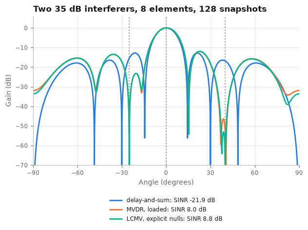
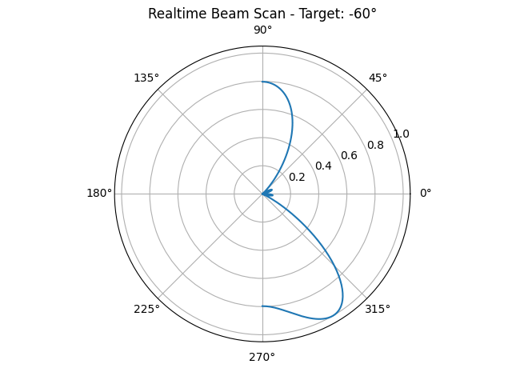
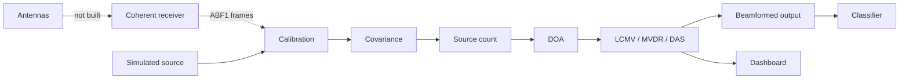

# Adaptive Beamforming Simulation

Adaptive beamforming, direction finding and interference rejection for antenna arrays: a tested
Python reference, a portable C core and an embedded receive pipeline. Receive-only.

[](https://github.com/JoachimNadal/Adaptive-Beamforming-Simulation/actions/workflows/ci.yml)
[](LICENSE)



## Overview

Several antennas receive the same wave at slightly different times. Combining them with the right
complex weights creates a spatial filter: gain toward a wanted signal, nulls toward interference.
This repository covers the chain from wave physics to an adaptive receiver, and is the companion
code of the course [`beamforming_course.pdf`](beamforming_course.pdf)
([French version](cours_beamforming.pdf)).

> **Validation status.** Everything here is simulated or run on a development PC and in CI.
> **No hardware exists and nothing has been physically validated.** See
> [validation](docs/VALIDATION.md) and [hardware status](docs/hardware/README.md).

## Features

| Area | Implemented |
|---|---|
| Arrays | uniform linear, uniform circular |
| Beamforming | Delay-and-Sum, null steering, MVDR/Capon, LCMV with derivative constraints |
| Supervised adaptation | LMS, NLMS, RLS |
| Direction of arrival | Bartlett, Capon, MUSIC, root-MUSIC, ESPRIT, MDL/AIC, Cramér–Rao bound |
| Environment | calibrated noise, Rayleigh/Rician/Clarke fading, multipath, five interference waveforms |
| Robustness | diagonal loading, forward-backward, spatial smoothing, channel calibration |
| Embedded | ABF1 IQ protocol, adaptive pipeline with explicit degradation, C99 core, batched MVDR |
| AI | synthetic dataset, CNN and baseline classifiers, streaming inference |
| Visualisation | dashboard, reproducible figures |

Not implemented: 2-D arrays, full wideband beamforming, sparse methods, MIMO, any RF hardware.

### Realtime beam scanning



## Quick start

Python 3.11 or later.

```bash
git clone https://github.com/JoachimNadal/Adaptive-Beamforming-Simulation.git
cd Adaptive-Beamforming-Simulation
python -m venv .venv && source .venv/bin/activate   # Windows: .venv\Scripts\activate
pip install -r requirements.txt

python examples/run_mvdr_demo.py
python examples/run_full_pipeline.py
python -m dashboard.app
```

| Extra | Command | For |
|---|---|---|
| Development | `pip install -e ".[dev]"` | tests, lint, types |
| AI | `pip install -e ".[ai]"` | training the CNN (PyTorch) |
| C core | CMake ≥ 3.16 and a C99 compiler | `embedded/core` |

## Example

```python
import numpy as np

from dsp.covariance_matrix import compute_covariance_matrix
from dsp.signal_metrics import output_sinr, to_db
from simulations.antenna_array.linear_array import LinearArray
from simulations.beamforming.mvdr import MVDRBeamformer
from simulations.scenarios.array_snapshots import simulate_array_snapshots

array = LinearArray(num_elements=8, spacing=6.25)  # cm, half wavelength at 2.4 GHz
scene = simulate_array_snapshots(
    array, 12.5, angles_deg=[0, -25], powers=[1, 1000], num_snapshots=256, rng=0
)
R = compute_covariance_matrix(scene.X)
w = MVDRBeamformer(array, relative_loading=1e-2).compute_weights(R, 0, 12.5)
sinr = output_sinr(w, scene.A[:, 0], 1.0, scene.R_interference_noise)
print(f"output SINR {to_db(sinr):.1f} dB, at most {10 * np.log10(8):.1f} dB")
```

## Selected results

Simulated; each is asserted by a test or produced by a script.

| Result | Value |
|---|---|
| Sample MVDR loss | matches Reed–Mallett–Brennan within 0.01 |
| root-MUSIC error | within about 6 % of the Cramér–Rao bound, −5 to 20 dB SNR |
| Pipeline, 8 elements, two 35 dB interferers | 8.79 dB SINR (optimum 8.79, Delay-and-Sum −21.9) |
| Calibration from 16° RMS channel errors | 0.19° RMS |
| C core, 4 antennas, one i7-9700K core | 153 MS/s weights, 0.25 µs MVDR |
| CNN on synthetic waveforms | 99.2 %, baseline 91.2 % |

## Architecture



| Folder | Content |
|---|---|
| [`dsp/`](dsp/README.md) | array-processing kernels |
| [`simulations/`](simulations/README.md) | arrays, channels, beamformers, DOA, scenarios |
| [`embedded/`](embedded/README.md) | protocol, pipeline, receiver, C core, target notes |
| [`ai/`](ai/README.md) | interference classification |
| [`dashboard/`](dashboard/README.md) | live view |
| [`examples/`](examples/README.md) | runnable demos |
| [`tests/`](tests/README.md) | test suite |
| [`scripts/`](scripts/README.md) | figures, error budget, errata, mutation check |
| [`docs/`](docs/README.md) | documentation index |
| [Guide](Beamforming_Theory_to_Embedded_Guide.md) | guided tour from waves to embedded |

## Testing

```bash
pytest                                # 249 tests with PyTorch, CMake and a compiler installed
ruff check . && ruff format --check . && mypy
python scripts/mutation_check.py      # injects 18 known bugs, all must be caught

cmake -S embedded/core -B build && cmake --build build && ctest --test-dir build
```

## Hardware

Planned targets: Raspberry Pi 5, Jetson Orin Nano, Zynq, coherent multichannel receivers. None has
been used. What a receiver must provide is in
[docs/hardware/requirements.md](docs/hardware/requirements.md): common LO and clock, 1° RMS phase
after calibration for −43 dB nulls, at least 10 bits and 15 dB of headroom for 40 dB interference.

## Project status

- [Audit of the original state](docs/PROJECT_AUDIT.md)
- [Validation report](docs/VALIDATION.md)
- [Roadmap and known limits](docs/ROADMAP.md)
- [Course errata](docs/theory/course_errata.md)

## License

[MIT](LICENSE)

## Disclaimer

For education, research, passive RF analysis and defensive communications research. The repository
does not implement jamming, offensive electronic warfare, signal disruption or any transmission.
See [legal and ethical notes](docs/safety/legal_and_ethics.md).
