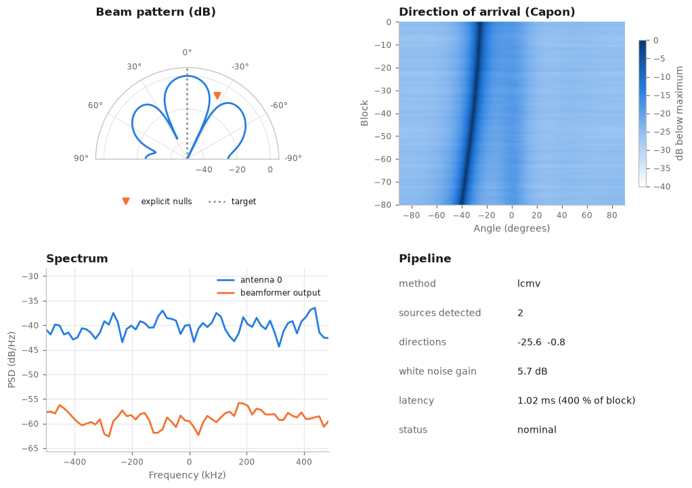

# dashboard — live view of the pipeline

```bash
python -m dashboard.app                       # simulated moving interferer
python -m dashboard.app --udp 5600            # ABF1 frames from the network
python -m dashboard.app --snapshot view.png   # headless
```

| File | Panel |
|---|---|
| `polar_plot.py` | current beam pattern and explicit nulls |
| `heatmap.py` | Capon spectrum over time |
| `spectrum_view.py` | one antenna against the beamformer output |
| `metrics_panel.py` | method, directions, white noise gain, latency, status |
| `app.py` | layout, sources, command line |



`latency` is compared with the duration of a block: above 100 % the Python pipeline is slower than
real time at that sample rate.
