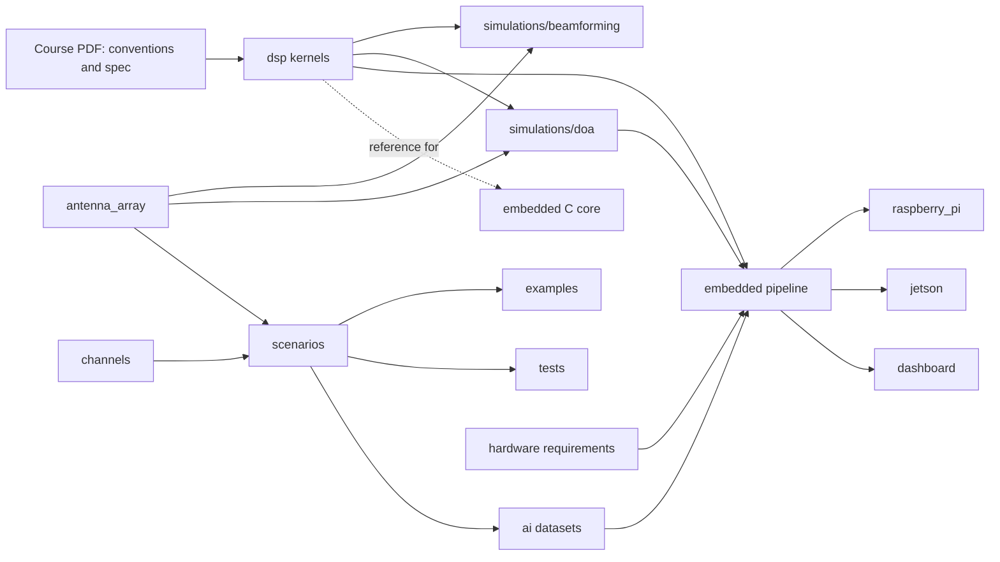

# Project Audit

| | |
|---|---|
| Audited revision | `8f91f28` (`origin/main`, 115 commits) |
| Method | Full read of every non-empty source and documentation file, targeted reading of the 187-page course PDF (conventions, all listings, chapters 22–24, Appendix C), inspection of the git history including deleted files, and execution of every test and example **unmodified** |
| Scope | Baseline **before** Phase 1 changes. What was done about each item is in [VALIDATION.md](VALIDATION.md) and the [roadmap](ROADMAP.md) |

Environment of the baseline measurements: Windows 11, Python 3.11.18, NumPy 2.4.6,
Matplotlib 3.11.2 (Agg backend), pytest 9.2.0.

---

## 1. Executive summary

The repository is the companion code of a serious 187-page course
(`beamforming_course.pdf`), but it is mostly a **skeleton**: 50 of its 93 files are
empty. What is implemented (the array model, DAS, MVDR, null steering, LMS, RLS) has
the right structure and correct core formulas, and is worth keeping.

Three findings dominate everything else.

1. **The adaptive simulations were silently wrong.** `spatiotemporal_signal.py` used
   the opposite phase sign from `LinearArray`. The project's own MVDR test passes
   while the beamformer attenuates the wanted signal by **46 dB** (output SINR
   −28.2 dB; the optimum for that scene is +20.0 dB).
2. **There is no hardware or firmware to complete.** No schematic, PCB, BOM, Gerber,
   HDL or microcontroller source exists anywhere, in the tree or in the history.
3. **The README describes features that do not exist**: MUSIC, ESPRIT, Capon DOA,
   channel models, spectrograms, CNN, dashboard and the embedded targets are 1-byte
   files. The documented quick start fails on its first command.

---

## 2. Architecture as found

```text
            ┌────────────────────── implemented ──────────────────────┐
LinearArray ─► scenario generators ─► covariance ─► DAS/MVDR/null ─► pattern plot
                                  └──────────────► LMS / RLS ───────► learning curve

            ┌──────────────────────── empty ──────────────────────────┐
 channels/   doa/   ai/   dashboard/   embedded/   most of docs/
```

| Folder | Intended purpose | Implemented | Empty |
|---|---|---|---|
| `simulations/antenna_array` | Array geometry, steering vectors | `linear_array` | `circular_array` |
| `simulations/beamforming` | Beamformers | all 5 | – |
| `simulations/scenarios` | Signal generation | 5 | `adaptive_tracking`, `interference_detection` |
| `simulations/channels` | Propagation and interference | none | all 4 |
| `simulations/doa` | DOA estimators | none | all 3 |
| `dsp` | Reusable kernels | `adaptive_weights`, `covariance_matrix` | `fft`, `filters`, `signal_metrics` |
| `ai` | Interference classification | none | all 8 |
| `dashboard` | Visualisation | none | all 5 |
| `embedded` | Pi / Jetson / FPGA targets | none | all 5 |
| `examples` | Demos | 10 | `run_music_demo`, `run_full_pipeline`, `run_ai_detection` |
| `tests` | Unit tests | 5 tests | – |
| `docs` | Theory and architecture | `theory/beamforming` | 7 |
| `assets` | Figures | 6 | 5 placeholder folders |
| root | Guide, course PDFs, licence | – | guide sections 10–18 listed but unwritten |

`examples/__init__.py` and the `simulations/*/__init__.py` files are legitimately empty.
`dsp/`, `ai/`, `dashboard/`, `simulations/doa`, `simulations/channels` and
`simulations/scenarios` have no `__init__.py` and only import as namespace packages.

### Design decisions recovered from the code and the course

| Decision | Source | Verdict |
|---|---|---|
| Phase convention a_m(θ) = exp(−j·m·k·d·sinθ), output y = wᴴx, angle from broadside | course, *Conventions*; `linear_array.py`; `docs/theory/beamforming.md` | **Adopted as the single project convention** |
| `X` is antennas × snapshots, R = X·Xᴴ / K | course; `covariance_matrix.py` | Keep |
| 4-element ULA, λ = 12.5 cm (2.4 GHz), d = 6.25 cm = λ/2 | every example | Keep as the reference array |
| One class per beamformer wrapping an array object | `simulations/beamforming` | Keep |
| `dsp/` holds kernels independent of simulation and plotting | `lms_update`, `compute_covariance_matrix` | Keep and extend: it is what gets ported to C |
| Passive / receive-only scope | README disclaimer | Keep |

---

## 3. Verified defects

Each one was reproduced on the unmodified code. "Measured" values come from execution.

### Critical — wrong results

| ID | Location | Defect | Measured consequence |
|---|---|---|---|
| D1 | `scenarios/spatiotemporal_signal.py` | Phase is +m·k·d·sinθ; `LinearArray` uses − | A noiseless source at +20° appears at **−20°**. MVDR steered to +20° attenuates the real source by **46.5 dB**; SINR **−28.2 dB**, worse than one antenna (+1.7 dB); optimum +20.0 dB |
| D2 | `tests/test_mvdr.py` | Checks the weights against `LinearArray` vectors, never against the simulated signal | Passes with D1 present. LMS/RLS tests also cannot see D1 because a reference-trained filter has no angle |
| D3 | `scenarios/multi_source.py`, `snapshot_generator.py` | Both sources keep a constant amplitude over all snapshots, so they are **fully coherent** | Covariance is rank 1 plus noise (eigenvalues 6.02, 0.041, 0.040, 0.039). In `run_mvdr_demo.py` MVDR puts **+2.9 dB toward the interferer** and cancels the wanted signal (output amplitude 0.02) |
| D4 | all generators | Noise is √σ² · (n₁ + j·n₂) | Noise power is **2×** the requested value (0.0397 for 0.02), a 3 dB bias on every SNR |
| D5 | `run_covariance_demo.py`, `run_multi_source_demo.py`, guide §8 | Pass radians while the default unit is degrees | Simulates **0.35°** instead of 20° |
| D6 | `Beamforming_Theory_to_Embedded_Guide.md` §5 | Uses exp(+j…); gives a(30°) = [1, j, −1, −j] | Code and course give [1, −j, −1, j] |

### Major — wrong in some cases

| ID | Location | Defect | Consequence |
|---|---|---|---|
| D7 | `mvdr.py`, `null_steering.py` `compute_beam_pattern` | The degree scan grid is passed with the caller's `unite` | With `unite="rad"`, a 20° target peaks at −60° |
| D8 | `linear_array.py` | Unknown unit strings are treated as radians | `unite="degrees"` silently gives wrong angles |
| D9 | `mvdr.py` | `np.linalg.inv`, no loading, no conditioning check | With K = 2 < N returns meaningless weights without any error |
| D10 | `null_steering.py` | Explicit inverse, one interferer only | Coincident directions raise a bare `LinAlgError` |
| D11 | `rls.py` | `P` is never re-symmetrised, gain denominator is complex | Course §13.12 requires both for stability |
| D12 | all pattern methods | 5° scan grid | Nulls and peaks between grid points are invisible |
| D13 | `linear_array.py` vs beamformers | Default unit is `rad` in one and `deg` in the others | Source of D5 |

### Minor — engineering quality

| ID | Defect |
|---|---|
| D14 | README quick start fails: `requirements.txt` is missing, the clone URL says `yourname`, and `python examples/run_mvdr_demo.py` raises `ModuleNotFoundError: simulations` |
| D15 | No packaging metadata, dependency declaration, linting configuration or CI |
| D16 | Computation methods call `plt.show()`, so tests open or warn about windows |
| D17 | No random seed anywhere: no figure or test is reproducible |
| D18 | Per-sample Python loops; `run_mvdr_demo.py` draws 200 000 snapshots one by one |
| D19 | The same beam-pattern loop is written four times |
| D20 | `.gitignore` excludes `*.png`, so new figures would silently not be committed |
| D21 | File-name typos: `multipatch.py`, `interferance_models.py`, `rf_interferance.md` |
| D22 | `steering_phases_simulation.png` is a desktop window screenshot |
| D23 | `run_realtime_beam_scan.py` overwrites a tracked asset on each run |
| D24 | `LinearArray` has an unneeded `cmath` scalar loop, prints from a plot method and mutates `self` on every call |

---

## 4. Missing components

| Area | Missing |
|---|---|
| DSP | FFT/PSD tools, filters, metrics (SINR, WNG, null depth, beamwidth), forward-backward averaging, spatial smoothing, diagonal loading, calibration |
| Beamforming | LCMV and NLMS, which the course's integrated chain (§24) and adaptive chapters (§12) require |
| DOA | Capon, MUSIC, ESPRIT, source-number detection, Cramér–Rao bound to judge them against |
| Channel | AWGN, fading, multipath, interference waveforms |
| AI | Everything: dataset, features, model, training, evaluation, inference |
| Dashboard | Everything |
| Embedded | Data format, configuration, processing pipeline, error handling, C kernels, build, tests |
| Hardware | **Everything** — see §5 |
| Docs | 7 of 8 pages; guide sections 10–18; README accuracy |
| Course promises | Appendix C.1 refers to `scripts/generate_figures.py`; it does not exist here |

### Course chapters versus code

| Course part | Chapters | Baseline | Phase 1 decision |
|---|---|---|---|
| I–II Foundations, deterministic | 1–8 | implemented | fix and complete |
| III Statistical | 9–11 | partial (no LCMV) | complete |
| IV Iterative | 12–13 | partial (no NLMS) | complete |
| V DOA | 14–17 | empty | implement |
| V Sparse/Bayesian | 18 | absent | **deferred to Phase 2** — no folder exists for it |
| VI Wideband, MIMO, 2-D/near field | 19–21 | absent | **deferred to Phase 2** — explicitly R&D topics |
| VII Calibration, robustness, chain | 22–24 | absent | implement: required by the embedded pipeline |

---

## 5. Hardware and PCB status

Searched: working tree, all 115 commits and all deleted paths, for KiCad, Altium, Eagle,
Gerber, BOM, netlist, HDL and MCU sources. **Result: zero files.** The only deleted paths
are empty placeholders.

The hardware information that does exist is limited to:

- the simulated array (4 elements, λ/2 at 2.4 GHz),
- `assets/images/schema/explanation1.png` (illustrative diagram),
- README "planned targets": Raspberry Pi 5, Jetson Orin Nano, Zynq, "SDR-based passive
  receivers", without any part number, interface or connection,
- guide headings "15. Embedded Hardware Architecture" and "16. Antenna Array Design"
  with no body.

**Consequence.** There is no PCB baseline to finish, and inventing one in Phase 1 would
violate both "do not redesign the hardware" and "never invent hardware specifications".
Phase 1 therefore produces what can be *derived* from the simulation — requirements,
error budgets, interface definition, power/grounding/RF constraints as requirements, and
array geometry — and marks schematic, layout, BOM, pinout and Gerbers as **not
existing**. Creating them is a Phase 2 project.

---

## 6. Course PDF review

The PDFs are build outputs; their LaTeX sources are not in the repository, so they cannot
be corrected here. The checks below were executed. Details and reproduction:
[theory/course_errata.md](theory/course_errata.md).

| ID | Location | Finding |
|---|---|---|
| E1 | Listings 16.1 / C.1 `esprit(tls=True)` | `full_matrices=False` makes the SVD block non-square when 2L > N−1. **Crashes** for N=4/L=2, N=6/L=3, N=8/L=4 |
| E2 | §24.8 table | Reports 18–22 dB output SINR; the stated scene (N=8, SNR 0 dB) is bounded by N·SNR = **9.03 dB**, computed optimum **8.79 dB** |
| E3 | Listing 24.1 | Source counting uses the *loaded* covariance: on the book's own scenario it finds L = 2 in 200/200 trials, so **both jammers never receive an explicit null** |
| E4 | Listing 24.1 | Takes the largest grid points instead of local maxima |
| E5 | Listing 22.1 | Averages raw snapshots, which only works for a constant source; the eigenvector method of §22.2.3 is the general one |
| E6 | Appendix C.1 | Refers to a script that is not in the repository |

---

## 7. Known limitations that Phase 1 cannot remove

| Limitation | Why |
|---|---|
| No physical measurement of anything | No hardware exists |
| No Raspberry Pi, Jetson or FPGA execution | Boards not available |
| AI trained on synthetic signals only | No recorded IQ dataset |
| Course PDFs stay uncorrected | LaTeX sources absent |

---

## 8. Dependencies between parts



Consequence for ordering: the phase convention and noise model must be fixed first,
because every other component consumes them.

---

## 9. Prioritised completion roadmap

| Priority | Work | Resolves |
|---|---|---|
| **P0** | One convention enforced by tests; correct noise and source models; unit handling | D1–D8, D13, D17 |
| **P1** | Numerically safe kernels; LCMV/NLMS; metrics; packaging, lint, CI | D9–D12, D14–D20 |
| **P1** | DOA estimators with Cramér–Rao comparison; channel models; calibration | §4 |
| **P2** | Embedded: frame protocol, configuration, pipeline, C core with cross-checks | §4 |
| **P2** | AI chain, dashboard, remaining examples and scenarios | §4 |
| **P2** | Hardware requirements and interface documents | §5 |
| **P3** | Theory pages, guide 10–18, figures, errata, README, validation report | §4, §6 |
| **Phase 2** | PCB, wideband, sparse/robust/hybrid methods, real hardware | §4, §5 |
