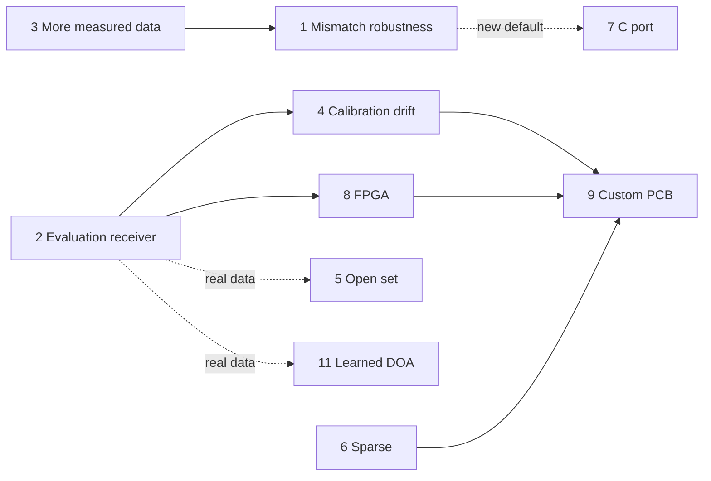

# Phase 2 — R&D Roadmap

Separate from the Phase 1 baseline (`v1.0.0-phase1`), which it does not modify. Updated 25 November 2026
after the first five studies. Reports: [research/README.md](../research/README.md).

Effort: S = days, M = weeks, L = months. Cost class: 0 = none, 1 = evaluation hardware, 2 = custom PCB
and test equipment.

## What the studies changed

| Preliminary claim | After the study | Report |
|---|---|---|
| Covariance reconstruction first (0.2 dB in the probe) | **withdrawn**: best with perfect calibration, worst of all methods from 1° of channel error | [1](../research/covariance/REPORT.md) |
| Noise-referenced loading as a default | best in simulation, **worse than relative loading on measured channels**: not adopted | [1](../research/covariance/REPORT.md), [5](../research/measured/REPORT.md) |
| Phase 1 pipeline limited by loading | limited by its **explicit nulls** when channels are not perfectly calibrated | [1](../research/covariance/REPORT.md) |
| 97 % rejection of unknown waveforms | **withdrawn** (two easy families): about 70 % at 5 % false alarms over 11 families, mean AUROC 0.916 | [2](../research/open_set/REPORT.md) |
| C port "low difficulty", 100 µs target | done; float32 covariances fail from about 60 dB, square-root processing works | [3](../research/c_port/REPORT.md) |
| Five sources with four antennas, 50 of 50 | true in a friendly scene; **65 % and 28 %** with combined imperfections | [4](../research/sparse/REPORT.md) |
| 4 channels on an evaluation platform, "decisive" | still decisive; two-channel radios validate too little; best candidate identified | [survey](../research/hardware/RECEIVER_SURVEY.md) |

Of 37 pre-registered hypotheses, 21 were refuted, 13 supported, 2 supported only in part and 1 was
ill-posed. All stay in [HYPOTHESES.md](../research/HYPOTHESES.md).

## Ranking

| Rank | Project | Interest | Feasibility | Impact | Effort | Cost class | Why here |
|---:|---|---|---|---|---|---|---|
| 1 | Robustness to real steering mismatch | high | high | **high** | S–M | 0 | study 5 contradicts study 1 |
| 2 | Coherent receiver: ask, buy one, test | high | medium | **decisive** | M | 1 | nothing physical is validated |
| 3 | More measured data (other rooms, files) | high | high | high | S | 0 | one room is not evidence |
| 4 | Calibration and its drift | high | medium | high | M | 0, then 1 | explicit nulls need 1° |
| 5 | Open-set detection: use it as *monitor*, not as classifier | medium | high | medium | S | 0 | 70 % is not a decision |
| 6 | Efficient sparse estimators, order selection | medium | medium | medium | M | 0 | bound is 2 × lower |
| 7 | C port: NEON covariance, MCU build | medium | high | medium | M | 0 | portable C is done |
| 8 | Fixed-point and FPGA datapath | medium | high | medium, needs rank 2 | L | 0, then 1 | |
| 9 | Custom receiver PCB | high | low without rank 2 | high | L | 2 | |
| 10 | Wideband subband beamformer | medium | high | depends on bandwidth | M | 0 | |
| 11 | Learning-assisted DOA | medium | medium | low until data exist | L | 0 | |
| – | Hybrid analog/digital beamforming | – | – | none here | – | – | |

## 1. Robustness to real steering mismatch

| | |
|---|---|
| Problem | on measured channels the assumed steering vector is far from the true one (35° RMS); methods with little loading cancel the target |
| Hypotheses to register | steering vector estimated from the data (dominant eigenvector, MUSIC refined) loses less than geometric pointing; loading chosen from the estimated mismatch beats any constant; eigenspace projection holds over other rooms |
| Baselines | relative loading 1e-2, noise × 10, eigenspace, delay-and-sum, optimum for measured vectors |
| Validation | held-out files and rooms of the same family of datasets; cost in SINR and in operations |
| Risk | one dataset; jitter of that data may dominate |
| Rule | the Phase 1 default is not changed before this study is finished |

## 2. Coherent receiver

See [RECEIVER_SURVEY.md](../research/hardware/RECEIVER_SURVEY.md). Steps: ask the maker for phase stability,
buy one unit if eligible, run T1 (phase drift, restart), then T2 and T7. **Go / no-go at T1.** Decision
needed from the owner: eligibility and budget.

## 3. More measured data

Files of espargos-0001, 0002, 0005 and 0007 (0.1 to 10 GB each). Same procedure as study 5: calibration and
evaluation files never mixed, MD5 checked, data not committed. The published licence was confirmed only for
0001 (CC BY 4.0).

## 4. Calibration and its drift

Study 1: the explicit nulls of the Phase 1 pipeline lose 5 dB for 1° of channel error. Study 5: one
indoor position is not a calibration.

Hypothesis: gain and phase drifts can be followed from the covariance of the received signals between
two conducted calibrations, keeping the residual under 5° RMS. Probe: none yet. Simulate drift with
random walks on channel gains, compare self-calibration with periodic calibration, measure null depth
against time. Failure modes matter more than averages: a self-calibration that follows an
interferer would hide it.

## 5. Open-set detection

The detector finds about 70 % of unknown waveforms at 5 % false alarms: useful to *flag* an event for a
human or to trigger a recording, not to decide. On real noise the distance in the embedding is far more
reliable than the softmax confidence (1.6 % against 46 % false alarms on white noise). Next: longer windows,
more recordings, per-SNR operating points. Augmentation with impairments traded detection (70 → 56 %) for
robustness: the compromise must be chosen, not assumed.

## 6. Sparse arrays

Done in simulation. To do: an estimator closer to the Cramér–Rao bound (2.1 × above it now), number of
sources unknown, and the comparison of 0, 1, 4, 6 against a uniform array on measured data (rank 2, two
units). Beamforming near the target (+5 dB) is the safest benefit.

## 7. C port

Done on x86-64 and arm64. To do: NEON covariance, and an execution on a microcontroller (12.8 KiB of state in
float32). Use square-root processing when the dynamic range exceeds about 50 dB. The compiler for
Cortex-M was not on the PATH, so bare-metal sizes are unknown.

## 8. Fixed-point and FPGA datapath

Probe B: median null depth with quantised weights.

| Bits | 6 | 8 | 10 | 12 | 16 |
|---|---:|---:|---:|---:|---:|
| N=4 | −46 dB | −59 dB | −70 dB | −82 dB | −105 dB |
| N=8 | −49 dB | −62 dB | −75 dB | −87 dB | −111 dB |

Even 8-bit weights are better than any achievable calibration (−43 dB at 1° RMS): weight precision
will not be the bottleneck, so a narrow datapath is realistic. To study: covariance accumulator,
adder-tree growth, rounding modes, bit-accurate model before HDL.

## 9. Custom receiver PCB

Only after rank 2 has measured what is actually limiting. Concept to be evaluated, not a design:

| Aspect | Technical problem | Candidate solution | Benefit | Drawback | Validation |
|---|---|---|---|---|---|
| Clocking | skew drift between channels | single reference, symmetric fan-out, equal lengths | stable calibration | layout constraints | T1 |
| LO | random phase at start | devices with documented multichip synchronisation, or one shared external LO | repeatable phase | cost, power, spurs | T1 |
| Calibration | needs a source (R7) | switched noise source and equal splitter at the LNA inputs | automatic recalibration | insertion loss before the LNA raises the noise figure | T2 |
| Front end | 40–60 dB interferers | preselection filter, linear LNA, common AGC with 15 dB headroom | no clipping (R10) | filter loss and mismatch between channels (R14) | T3, T4 |
| Isolation | leakage limits nulls (R25) | shielded channels, stitched ground, spacing | deeper nulls | area, cost | T6 |
| Stack-up | controlled impedance, return paths (R23, R24) | continuous ground next to the RF layer | predictable RF | layer count | impedance coupon |
| Supplies | differential ripple is phase noise (R21) | per-channel regulators | clean phases | power | T1 with injected ripple |
| Scalability | more channels | synchronised 4-channel tiles | reuse | inter-tile synchronisation | T1 across tiles |

Component selection, stack-up and cost need datasheets and quotes: not done here.

## 10. Wideband

Probe D: optimum SINR over a 10 % band, 30 dB interferers.

| Scene | 1 weight set | 4 subbands | 64 subbands |
|---|---:|---:|---:|
| N=4, one interferer | 5.6 | 5.7 | 5.7 |
| N=4, two interferers | **1.5** | 5.1 | 5.5 |
| N=8, three interferers | 7.7 | 8.4 | 8.9 |

Spare degrees of freedom absorb the bandwidth. Subbands matter when they run out. Below 1 %
bandwidth it is not needed at all. References: Frost, 1972.

## 11. Learning-assisted DOA

Classical estimators are within 6 % of the Cramér–Rao bound on the baseline model, so there is
nothing to gain there. The case for learning is coherent sources, few snapshots and mismatched
arrays. Keep subspace structure (SubspaceNet) rather than a black box. Wait for real data.

Reference: Shmuel et al., 2025.

## Not recommended: hybrid beamforming

It reduces the number of converters in large arrays. With 4 to 8 receive channels, full digital is
cheaper and better. No literature review was done.

## Proposed order

Decision needed from the project owner: eligibility and budget for rank 2. Ranks 1, 3, 5, 6 and 7 need
none.

## References

Bibliographic data checked by web search unless marked †, which comes from the course bibliography.

- S. A. Vorobyov, A. B. Gershman, Z.-Q. Luo, "Robust adaptive beamforming using worst-case
  performance optimization: a solution to the signal mismatch problem", *IEEE Trans. Signal
  Processing* 51(2), 313–324, 2003.
- Y. Gu, A. Leshem, "Robust adaptive beamforming based on interference covariance matrix
  reconstruction and steering vector estimation", *IEEE Trans. Signal Processing* 60(7), 3881–3885,
  2012.
- † J. Li, P. Stoica, Z. Wang, "On robust Capon beamforming and diagonal loading", *IEEE Trans.
  Signal Processing* 51(7), 1702–1715, 2003, doi:10.1109/TSP.2003.812831.
- P. Pal, P. P. Vaidyanathan, "Nested arrays: a novel approach to array processing with enhanced
  degrees of freedom", *IEEE Trans. Signal Processing* 58(8), 4167–4181, 2010,
  doi:10.1109/TSP.2010.2049264 (an erratum exists).
- O. L. Frost, "An algorithm for linearly constrained adaptive array processing", *Proc. IEEE* 60(8),
  926–935, 1972, doi:10.1109/PROC.1972.8817.
- D. H. Shmuel et al., "SubspaceNet: deep learning-aided subspace methods for DoA estimation", *IEEE
  Trans. Vehicular Technology* 74(3), 4962–4976, 2025, arXiv:2306.02271.
- K. Lee, K. Lee, H. Lee, J. Shin, "A simple unified framework for detecting out-of-distribution
  samples and adversarial attacks", NeurIPS 2018, arXiv:1807.03888.
- C. Fernández-Prades, J. Arribas, P. Closas, "Robust GNSS receivers by array signal processing:
  theory and implementation", *Proc. IEEE*, 2016 (system-level reading for ranks 2 and 8).
- Analog Devices, [FMCOMMS5 phase synchronisation](https://analogdevicesinc.github.io/documentation/solutions/reference-designs/fmcomms5/phase-sync.html),
  [AD9361 multichip synchronisation](https://analogdevicesinc.github.io/documentation/solutions/reference-designs/fmcomms5/multi-chip-sync.html),
  [ADRV9009](https://www.analog.com/en/products/adrv9009.html).
- F. Euchner, S. ten Brink, "CSI Dataset espargos-0001: Four antenna arrays in indoor lab room", DaRUS,
  2024, doi:10.18419/DARUS-4352.
