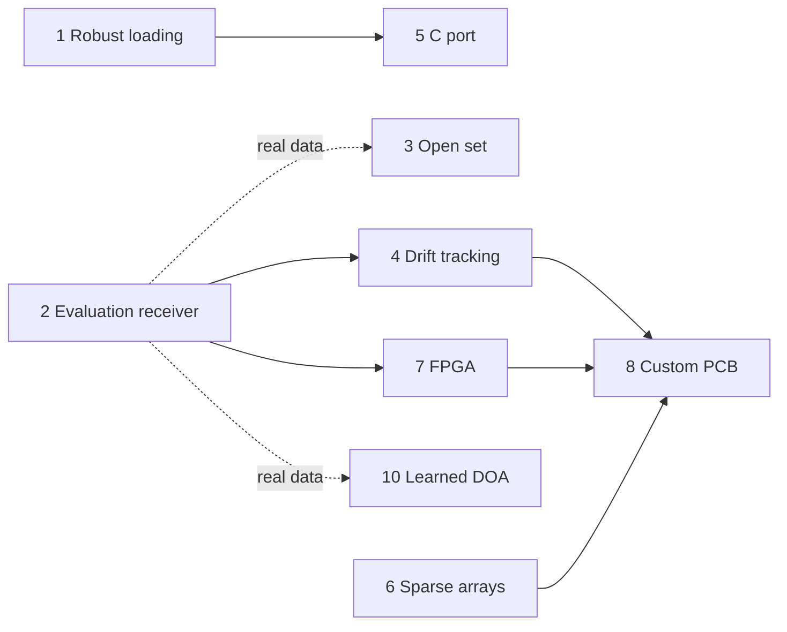

# Phase 2 — R&D Roadmap (preliminary)

Separate from the Phase 1 baseline, which it does not modify. Ranking is based on the limits
measured in Phase 1 and on small probes:

```bash
python research/feasibility_probes.py
python research/feasibility_probes.py novelty   # needs PyTorch and a trained model
```

**Status: preliminary.** Probes are simulations with ideal models and few scenes; they show whether
a direction deserves a study, nothing more. No cost below is a quote: prices were not researched.

Effort: S = days, M = weeks, L = months. Cost class: 0 = none, 1 = evaluation hardware, 2 = custom PCB
and test equipment.

## Ranking

| Rank | Project | Interest | Feasibility | Impact | Effort | Cost class |
|---:|---|---|---|---|---|---|
| 1 | Robust loading and covariance reconstruction | high | high | high | S–M | 0 |
| 2 | Coherent receiver on evaluation hardware | high | medium | **decisive** | M | 1 |
| 3 | Open-set classification | medium | high | medium | S | 0 |
| 4 | Calibration-drift tracking | high | medium | high | M | 0, then 1 |
| 5 | C port of order/DOA/LCMV | medium | high | medium | M | 0 |
| 6 | Sparse arrays | high | high in simulation | medium | M | 0 |
| 7 | Fixed-point and FPGA datapath | medium | high | medium, needs rank 2 | L | 0, then 1 |
| 8 | Custom receiver PCB | high | low without rank 2 | high | L | 2 |
| 9 | Wideband subband beamformer | medium | high | depends on bandwidth | M | 0 |
| 10 | Learning-assisted DOA | medium | medium | low until real data exist | L | 0 |
| – | Hybrid analog/digital beamforming | – | – | none here | – | – |

Rank 2 outweighs everything after rank 1: until a real coherent channel exists, every further
algorithm is judged on the same idealised model.

## 1. Robust loading and covariance reconstruction

| | |
|---|---|
| Problem | Relative loading scales with the interferer (limit L8); self-cancellation with pointing errors |
| Hypothesis | Noise-referenced loading, or rebuilding the interference covariance from the Capon spectrum outside the target sector, stays within 0.5–1.5 dB of the optimum from 20 to 60 dB INR |
| Probe A, loss in dB, N=4, 2° error, 10 dB target | see table |
| Validation | loss ≤ 1 dB over INR 0–60 dB, pointing ≤ 2°, K ≥ 2N, channel errors ≤ 5°; compared with the pipeline including its explicit nulls |
| Difficulty | low: closed form, $O(N^3)$ plus a grid |

| INR | MVDR 1e-2 | LCMV derivative 1e-2 (no explicit null) | LCMV derivative, 10 × noise | Reconstruction |
|---:|---:|---:|---:|---:|
| 20 dB | 6.0 | 1.1 | 1.0 | **0.3** |
| 40 dB | 0.7 | 1.1 | 1.0 | **0.2** |
| 60 dB | 2.9 | 8.1 | 1.0 | **0.2** |

With N=8 the figures are 0.5 dB for reconstruction and 1.5 dB for noise-referenced LCMV. Noise
loading *without* the derivative constraint is worse than relative loading in that case (7.3 dB):
it is not a drop-in replacement. Caveats: the probe's noise estimate assumes the number of sources
is known, and reconstruction relies on a calibrated manifold — the dependence on channel errors must
be measured first. In the shipped pipeline explicit nulls already limit the loss to 0.2 dB when the
target direction is exact.

References: Li, Stoica and Wang, 2003; Vorobyov, Gershman and Luo, 2003; Gu and Leshem, 2012.

## 2. Coherent receiver on evaluation hardware

| | |
|---|---|
| Problem | nothing has been physically validated (L1) |
| Proposal | four coherent channels from an existing multichannel evaluation platform; ABF1 bridge; conducted calibration source; tests T1–T7 of [requirements.md](hardware/requirements.md) |
| Hypothesis | after conducted calibration, residual phase ≤ 5° RMS and a null deeper than 25 dB on a real source |
| Constraint found | AD9361 has no internal RF phase synchronisation, so calibration after every LO start is mandatory (FMCOMMS5 reference design). ADRV9009 documents multichip LO phase synchronisation |
| Alternative | KrakenSDR: coherent and simple, but 24–1766 MHz and 8 bits: array to be rescaled, 4.2 dB loss at 40 dB INR in the error budget |
| Required | platform, power splitter, switched noise source, antennas, two independent signal sources, anechoic space or open site |
| Difficulty | medium: drivers, clocking, RF practice |
| Legal | receive-only; conducted sources ([notes](safety/legal_and_ethics.md)) |

## 3. Open-set classification

Probe E: Mahalanobis distance in the existing CNN embedding rejects **97.0 %** of waveforms absent
from training for 5 % of known ones (AUC 0.985), against 2.8 % for the confidence threshold. No
retraining. Validation: more unseen families, per-SNR curves, then recordings. The two unseen
families of the probe are few; this number will not hold everywhere.

Reference: Lee et al., 2018.

## 4. Calibration-drift tracking

Hypothesis: gain and phase drifts can be followed from the covariance of the received signals between
two conducted calibrations, keeping the residual under 5° RMS. Probe: none yet. Simulate drift with
random walks on channel gains, compare self-calibration with periodic calibration, measure null depth
against time. Failure modes matter more than averages: a self-calibration that follows an
interferer would hide it.

## 5. C port of order estimation, DOA and LCMV

Removes limit L10. Needs a Hermitian eigenvalue solver (cyclic Jacobi, N ≤ 16) and a small complex
solver. Validation: existing Python cross-checks; target under 100 µs per update for N=8 on the CI
arm64 runner, then on a board.

## 6. Sparse arrays

Probe C: four elements at positions 0, 1, 4, 6 (in λ/2) locate **five** uncorrelated sources in
50 trials out of 50 (RMSE 0.11°, 4000 snapshots, 10 dB), which no 4-element uniform array can do.
Beamwidth 12.2° instead of 26.3°, at the price of −5.3 dB sidelobes instead of −11.3 dB. The gain
relies on uncorrelated sources and many snapshots, and the ordinary beam is worse. Study: snapshots
needed against SNR, coherent sources, calibration errors, beamforming with virtual data.

Reference: Pal and Vaidyanathan, 2010.

## 7. Fixed-point and FPGA datapath

Probe B: median null depth with quantised weights.

| Bits | 6 | 8 | 10 | 12 | 16 |
|---|---:|---:|---:|---:|---:|
| N=4 | −46 dB | −59 dB | −70 dB | −82 dB | −105 dB |
| N=8 | −49 dB | −62 dB | −75 dB | −87 dB | −111 dB |

Even 8-bit weights are better than any achievable calibration (−43 dB at 1° RMS): weight precision
will not be the bottleneck, so a narrow datapath is realistic. To study: covariance accumulator,
adder-tree growth, rounding modes, bit-accurate model before HDL.

## 8. Custom receiver PCB

Only after rank 2 has measured what is actually limiting. Concept to be evaluated, not a design:

| Aspect | Technical problem | Candidate solution | Benefit | Drawback | Validation |
|---|---|---|---|---|---|
| Clocking | skew drift between channels | single reference, symmetric fan-out, equal lengths | stable calibration | layout constraints | T1 |
| LO | random phase at start | devices with documented multichip synchronisation, or one shared external LO | repeatable phase | cost, power, spurs | T1 |
| Calibration | needs a source (R7) | switched noise source and equal splitter at the LNA inputs | automatic recalibration | insertion loss before the LNA raises the noise figure | T2 |
| Front end | 40–60 dB interferers | preselection filter, linear LNA, common AGC with 15 dB headroom | no clipping (R10) | filter loss and mismatch between channels (R14) | T3, T4 |
| Isolation | leakage limits nulls (R25) | shielded channels, stitched ground, spacing | deeper nulls | area, cost | T6 |
| Stack-up | controlled impedance, return paths (R23, R24) | continuous ground next to the RF layer | predictable RF | layer count | impedance coupon |
| Supplies | differential ripple is phase noise (R21) | per-channel regulators | clean phases | power | T1 with injected ripple |
| Scalability | more channels | synchronised 4-channel tiles | reuse | inter-tile synchronisation | T1 across tiles |

Component selection, stack-up and cost need datasheets and quotes: not done here.

## 9. Wideband

Probe D: optimum SINR over a 10 % band, 30 dB interferers.

| Scene | 1 weight set | 4 subbands | 64 subbands |
|---|---:|---:|---:|
| N=4, one interferer | 5.6 | 5.7 | 5.7 |
| N=4, two interferers | **1.5** | 5.1 | 5.5 |
| N=8, three interferers | 7.7 | 8.4 | 8.9 |

Spare degrees of freedom absorb the bandwidth. Subbands matter when they run out. Below 1 %
bandwidth it is not needed at all. References: Frost, 1972.

## 10. Learning-assisted DOA

Classical estimators are within 6 % of the Cramér–Rao bound on the baseline model, so there is
nothing to gain there. The case for learning is coherent sources, few snapshots and mismatched
arrays. Keep subspace structure (SubspaceNet) rather than a black box. Wait for real data.

Reference: Shmuel et al., 2025.

## Not recommended: hybrid beamforming

It reduces the number of converters in large arrays. With 4 to 8 receive channels, full digital is
cheaper and better. No literature review was done.

## Proposed order



Decision needed from the project owner: budget and platform for rank 2. Ranks 1, 3, 5 and 6 can
start without any.

## References

Bibliographic data checked by web search unless marked †, which comes from the course bibliography.

- S. A. Vorobyov, A. B. Gershman, Z.-Q. Luo, "Robust adaptive beamforming using worst-case
  performance optimization: a solution to the signal mismatch problem", *IEEE Trans. Signal
  Processing* 51(2), 313–324, 2003.
- Y. Gu, A. Leshem, "Robust adaptive beamforming based on interference covariance matrix
  reconstruction and steering vector estimation", *IEEE Trans. Signal Processing* 60(7), 3881–3885,
  2012.
- † J. Li, P. Stoica, Z. Wang, "On robust Capon beamforming and diagonal loading", *IEEE Trans.
  Signal Processing* 51(7), 1702–1715, 2003, doi:10.1109/TSP.2003.812831.
- P. Pal, P. P. Vaidyanathan, "Nested arrays: a novel approach to array processing with enhanced
  degrees of freedom", *IEEE Trans. Signal Processing* 58(8), 4167–4181, 2010,
  doi:10.1109/TSP.2010.2049264 (an erratum exists).
- O. L. Frost, "An algorithm for linearly constrained adaptive array processing", *Proc. IEEE* 60(8),
  926–935, 1972, doi:10.1109/PROC.1972.8817.
- D. H. Shmuel et al., "SubspaceNet: deep learning-aided subspace methods for DoA estimation", *IEEE
  Trans. Vehicular Technology* 74(3), 4962–4976, 2025, arXiv:2306.02271.
- K. Lee, K. Lee, H. Lee, J. Shin, "A simple unified framework for detecting out-of-distribution
  samples and adversarial attacks", NeurIPS 2018, arXiv:1807.03888.
- C. Fernández-Prades, J. Arribas, P. Closas, "Robust GNSS receivers by array signal processing:
  theory and implementation", *Proc. IEEE*, 2016 (system-level reading for ranks 2 and 8).
- Analog Devices, [FMCOMMS5 phase synchronisation](https://analogdevicesinc.github.io/documentation/solutions/reference-designs/fmcomms5/phase-sync.html),
  [AD9361 multichip synchronisation](https://analogdevicesinc.github.io/documentation/solutions/reference-designs/fmcomms5/multi-chip-sync.html),
  [ADRV9009](https://www.analog.com/en/products/adrv9009.html).
