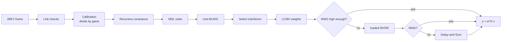

# Signal Pipeline

Implementation: `embedded/common/pipeline.py` (class `BeamformingPipeline`). It follows chapter
24 of the course, with the corrections of the [errata](../theory/course_errata.md).

## Stages

| Stage | Algorithm | Cost (per block of K) | Notes |
|---|---|---|---|
| Link checks | sequence, flags, finite values | $NK$ comparisons | see status flags |
| Calibration | divide by per-channel gain | $NK$ | known gains or one reference source |
| Covariance | recursive, $\beta$ | $K N(N+1)/2$ | reset on gain or clock change |
| Order | MDL with effective snapshots | eigenvalues $O(N^3)$ | unloaded covariance |
| Directions | root-MUSIC | $O(N^3)$ | ULA |
| Selection | least-squares source powers | $O(N^2L)$ | outside `guard_deg`, above `min_interferer_inr_db`, strongest first |
| Weights | LCMV | $O(N^3)$ | target, derivative, nulls |
| Application | $\mathbf w^H\mathbf X$ | $NK$ | same block: latency is one block plus computing time |

## Degrees of freedom

$N$ antennas give $N$ degrees of freedom: one for the target, one for the derivative constraint,
the rest for interference. When MDL reports $N-1$ sources or more the array is saturated:
explicit nulls and the derivative constraint are dropped so that the covariance can use every
degree of freedom. Simulated effect with 4 antennas and 3 interferers at 30 dB: −23.9 dB SINR
with the derivative constraint, +4.0 dB without (optimum 4.55 dB).

## Status flags

| Flag | Cause | Reaction |
|---|---|---|
| `UNCALIBRATED` | no gains loaded, or lost | process anyway |
| `SEQUENCE_GAP` | lost frames | none, reported |
| `ADC_OVERFLOW` | clipped block | weights held, output still produced |
| `CLOCK_UNLOCKED` | LO/ADC clock lost | calibration and covariance discarded, weights held |
| `INVALID_DATA` | NaN or infinity | output muted, weights held |
| `TOO_MANY_SOURCES` | order ≥ N−1 | no explicit null, no derivative constraint |
| `NULLS_DROPPED` | more interferers than allowed nulls | strongest kept |
| `FALLBACK_MVDR`, `FALLBACK_DAS` | WNG under `min_wng_ratio`·N or solver failure | simpler weights |
| `WEIGHTS_HELD` | no adaptation on this block | previous weights |

Bad data never raises; a wrong number of channels or an invalid calibration does, because it is
a setup error.

## Configuration

`embedded/config/reference_2g4.toml`, loaded by `load_config`. Unknown keys and inconsistent
values are errors.

| Key | Default | Meaning |
|---|---:|---|
| `num_elements` | 4 | 2 to 16 |
| `spacing_m` | 0.0625 | at most λ/2 |
| `carrier_hz` | 2.4e9 | defines λ |
| `target_deg` | 0 | look direction |
| `block_size` | 256 | snapshots per frame, at least N |
| `covariance_beta` | 0.5 | memory ≈ 1/(1−β) blocks |
| `relative_loading` | 1e-2 | relative to tr(R)/N |
| `max_interferers` | 2 | explicit nulls |
| `guard_deg` | 6 | estimates closer than this are the target |
| `min_interferer_inr_db` | 3 | weaker ones rely on the covariance |
| `derivative_constraint` | true | pointing tolerance |
| `min_wng_ratio` | 0.1 | fallback threshold (course §23.4.2) |

## Measured performance

Output SINR after 12 blocks, rng seed 0, simulated (optimum in brackets):

| Scene | SINR (dB) | Status |
|---|---|---|
| N=4, interferer −35° at 30 dB | 5.91 (5.93) | nominal |
| N=8, interferers −25° and 40° at 35 dB | 8.79 (8.79) | nominal |
| N=4, target 3° off, 20 dB; interferer −35° at 30 dB | 25.51 (25.82) | nominal |
| N=4, interferers −35°, 50°, 20° at 30 dB | 3.97 (4.55) | too many sources |
| N=4, interferer 4° from the target at 30 dB | −29.7 (−6.3) | fallback to Delay-and-Sum |

The last line is a limit, not a bug: 4° is far inside the 26° beam and inside the guard zone.

Processing latency on an i7-9700K: 1.2 ms for N=4, K=256 in Python, i.e. 0.2 MS/s. Real-time
operation at higher rates needs the C core; see [embedded_targets.md](embedded_targets.md).
