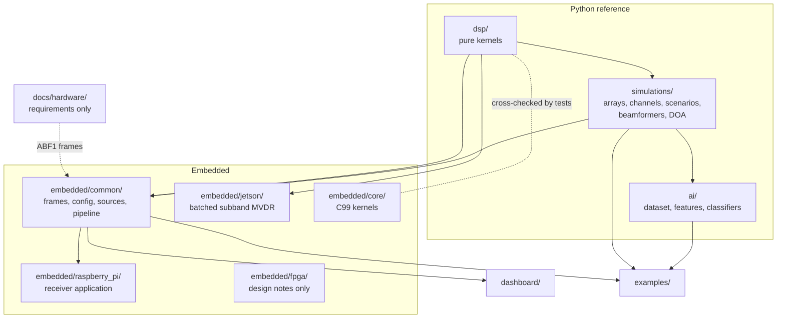

# System Architecture

## Layers

Dependencies only point downwards or sideways; `dsp/` imports nothing from the project.

| Layer | Rule |
|---|---|
| `dsp/` | NumPy in, NumPy out. No plotting, no randomness, no I/O |
| `simulations/` | owns randomness; every generator takes `rng` |
| `embedded/common/` | never raises on bad *data*, always reports a status |
| `embedded/core/` | no heap, no globals, caller-owned memory |
| plotting | never inside a computation; functions return axes |

## What exists, and how far it was validated

| Level | Meaning |
|---|---|
| **S** | validated in simulation against theory |
| **H** | executed on the development PC (Windows, i7-9700K) |
| **C** | executed by continuous integration (Linux x86-64 and arm64) |
| **G** | executed on a desktop GPU (RTX 2080 Ti) |
| **P** | physically validated on target hardware |

| Component | S | H | C | G | P |
|---|---|---|---|---|---|
| Beamformers, DOA, calibration | ✔ | ✔ | ✔ | – | ✘ |
| IQ frame format, Python and C | ✔ | ✔ | ✔ | – | ✘ |
| Adaptive pipeline, receiver application | ✔ | ✔ | ✔ | – | ✘ |
| C core | ✔ | ✔ | ✔ | – | ✘ |
| Batched MVDR | ✔ | ✔ | ✔ | ✔ | ✘ |
| CNN classifier | synthetic data | ✔ | – | – | ✘ |
| FPGA | design notes | ✘ | ✘ | – | ✘ |
| RF hardware, PCB | requirements | ✘ | ✘ | – | ✘ |

**Nothing in this project has been physically validated.** CI results are those of the
repository's Actions page; see [VALIDATION.md](../VALIDATION.md).

## Runtime view

See [signal_pipeline.md](signal_pipeline.md). Rates follow the course §24.3: weights are applied
at the sample rate, covariance and weights are refreshed once per block.

## Related documents

- [Signal pipeline](signal_pipeline.md) · [IQ frame protocol](iq_frame_protocol.md) ·
  [Embedded targets](embedded_targets.md) · [Decisions](decisions.md)
- [Hardware](../hardware/README.md) · [Theory](../theory/beamforming.md)
