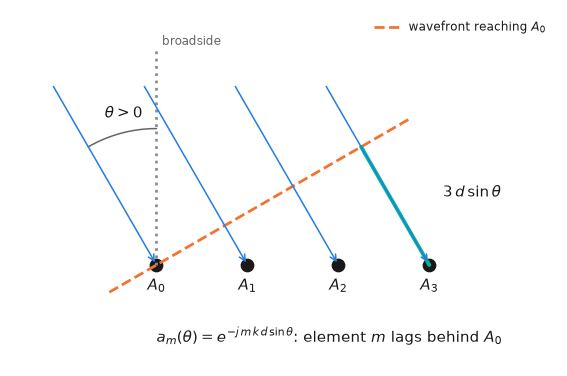

# Antenna Array

Geometry of the **simulated** reference array. It has not been built.

| Parameter | Value |
|---|---|
| Type | uniform linear array |
| Elements | 4 |
| Carrier | 2.4 GHz |
| Wavelength | 12.5 cm in the examples ($c\approx3\cdot10^8$); 12.491 cm exactly |
| Spacing | 6.25 cm |
| Aperture | 18.75 cm |
| Beamwidth | 26.3° at broadside |
| Peak sidelobe | −11.3 dB |
| Far field $2D^2/\lambda$ | 0.56 m |

The rounding of the wavelength makes $d/\lambda=0.5004$; its effect on angles is below 0.1° inside
±45° and the configuration tolerates it.

## Coordinates

Element 0 is the phase reference, x along the array, y toward broadside
([convention](../theory/beamforming.md#conventions)).

| Element | x (mm) | y (mm) |
|---:|---:|---:|
| A0 | 0.00 | 0.00 |
| A1 | 62.50 | 0.00 |
| A2 | 125.00 | 0.00 |
| A3 | 187.50 | 0.00 |

A source at positive angle is on the A0 side. Connecting the channels in reverse order mirrors
every angle, with no other symptom: verify with a source clearly on one side first.

## Scaling to other frequencies

$d=\lambda/2=c/2f$. All angles and patterns are unchanged if $d/\lambda$ is kept.

| Frequency | λ/2 |
|---|---:|
| 868 MHz | 172.7 mm |
| 1575.42 MHz | 95.1 mm |
| 2.4 GHz | 62.5 mm |
| 5.8 GHz | 25.8 mm |

## Circular alternative

`CircularArray.from_spacing(8, d)` places adjacent elements at distance $d$:
radius $d/(2\sin(\pi/8))=81.7$ mm for $d=62.5$ mm. Covers 360° but loses ESPRIT, root-MUSIC and
spatial smoothing.

## Not modelled

Element pattern, polarisation, mutual coupling, ground plane, edge effects. The photograph-like
figure `assets/images/schema/explanation1.png` is illustrative: the drawn gaps are unequal.
