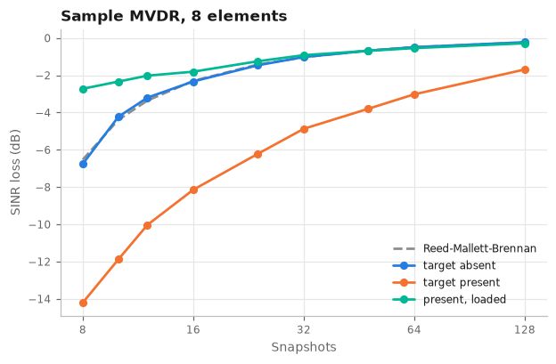
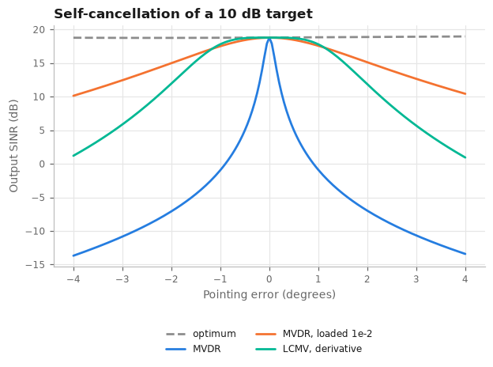
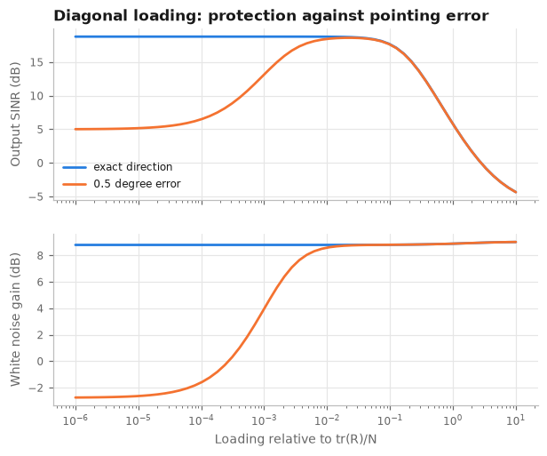
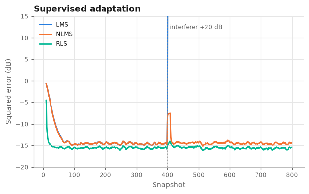
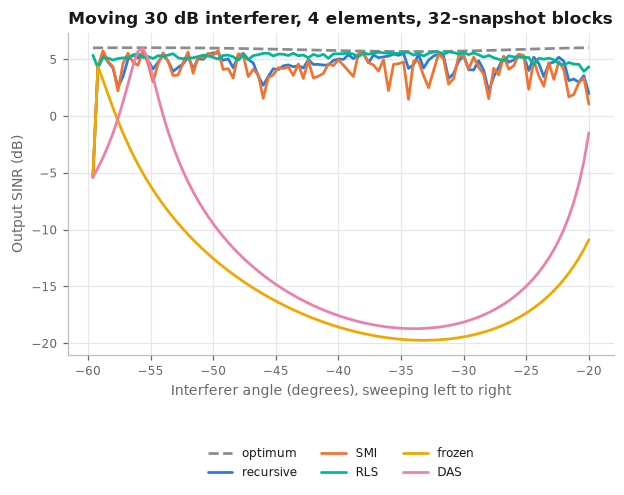

# Adaptive Algorithms

Every algorithm below is implemented, tested, and described with the same six points:
foundation, assumptions, implementation, complexity, advantages and limitations, validation.
Conventions are those of [beamforming.md](beamforming.md). Costs count complex
multiply-accumulates (cMAC); all measured figures come from this repository's own scripts and
are **simulations**.

| Symbol | Meaning |
|---|---|
| $N$, $K$, $L$ | antennas, snapshots, sources or constraints |
| $\mathbf R$ | covariance of everything received |
| $\mathbf R_{i+n}$ | covariance of interference plus noise only |
| $\alpha$ | diagonal loading |

## Covariance estimation

$\hat{\mathbf R}=\frac1K\mathbf X\mathbf X^H$ (`compute_covariance_matrix`), symmetrised to remove
round-off.

| Tool | Purpose | Function |
|---|---|---|
| Recursive average | $\hat{\mathbf R}\leftarrow\beta\hat{\mathbf R}+(1-\beta)\hat{\mathbf R}_{block}$, bias-corrected, with the equivalent number of blocks | `RecursiveCovariance` |
| Diagonal loading | conditioning and robustness | `diagonal_loading`, `loading_level` |
| Forward-backward | doubles the data for a ULA | `forward_backward` |
| Spatial smoothing | restores rank with coherent paths, costs aperture | `spatial_smoothing` |

Cost: $N(N+1)/2$ cMAC per snapshot using Hermitian symmetry (C: `abf_covariance_update`).

**A trap worth knowing.** An interferer that moves during the averaging window spreads over
several eigenvalues and is counted as several sources. With four antennas, $\beta=0.5$ and
about 1° of motion per block, the pipeline reports a saturated array although there are two
sources.

## MVDR / Capon

1. **Foundation.** $\min_{\mathbf w}\mathbf w^H\mathbf R\mathbf w$ subject to $\mathbf w^H\mathbf a=1$ gives
   $$\mathbf w=\frac{\mathbf R_\alpha^{-1}\mathbf a}{\mathbf a^H\mathbf R_\alpha^{-1}\mathbf a},\qquad \mathbf R_\alpha=\mathbf R+\alpha\mathbf I .$$
   With the exact $\mathbf R$ or $\mathbf R_{i+n}$ it attains the optimum SINR.
2. **Assumptions.** Exact target steering vector; sources uncorrelated with the target;
   stationarity over the window; $K\gtrsim2N$.
3. **Implementation.** Python: `mvdr_weights` (linear solve, never an inverse; refuses systems
   with condition number above 1e12). C: `abf_mvdr_weights` (trace normalisation, Cholesky,
   two triangular solves). Batched: `embedded/jetson/orin_pipeline.py`.
4. **Complexity.** About $N^3/6+N^2$ cMAC per update: 0.25 µs for $N=4$ and 1.7 µs for $N=16$
   with the C core on an i7-9700K.
5. **Advantages.** Needs no interferer direction; optimal in theory.
   **Limitations.** Self-cancellation: a 0.5° pointing error on a 10 dB target costs 14 dB
   (8 elements, exact covariance); coherent multipath defeats it.
6. **Validation.** Equality with the closed-form optimum; mean loss of the sample version
   equal to $(K-N+2)/(K+1)$ (Reed, Mallett, Brennan) within 0.01 over 1500 trials;
   limits $\mathbf R=\mathbf I$ and $\alpha\to\infty$ give Delay-and-Sum; float32 C within 0.1 dB of
   float64 up to a 60 dB interferer.

The orange curve is the practical lesson: with the **target present** in the snapshots the loss
is far larger than the textbook rule (8 dB instead of 2.3 dB at $K=2N$), and a moderate loading
removes most of it.

### Choosing the loading

`relative_loading` $=\alpha N/\mathrm{tr}(\mathbf R)$. The pipeline default is 1e-2.

Because it is relative to the *total* power, the loading grows with the interferer. Simulated loss
for N=4, K=256, target at 0 dB exactly in the look direction, 150 trials:

| INR | MVDR, 1e-2 | LCMV derivative, 1e-2 | MVDR, 10 × noise | LCMV derivative, 10 × noise |
|---:|---:|---:|---:|---:|
| 20 dB | 0.1 | 0.3 | 0.1 | 0.5 |
| 40 dB | 0.1 | 0.5 | 0.1 | 0.3 |
| 60 dB | **2.8** | **8.0** | 0.1 | 0.3 |

A loading proportional to the estimated *noise* has no such limit. It is not implemented: it needs
a reliable noise estimate, and is the first Phase 2 candidate. In the pipeline, explicit nulls
compensate as long as the interferer is found.

## LCMV

1. **Foundation.** $\min\mathbf w^H\mathbf R\mathbf w$ subject to $\mathbf C^H\mathbf w=\mathbf f$:
   $\mathbf w=\mathbf R_\alpha^{-1}\mathbf C(\mathbf C^H\mathbf R_\alpha^{-1}\mathbf C)^{-1}\mathbf f$.
2. **Assumptions.** As MVDR, plus constraint directions; at most $N$ constraints, linearly
   independent.
3. **Implementation.** `lcmv_weights`, `simulations/beamforming/lcmv.py`. Columns of $\mathbf C$:
   target, optional derivative, explicit nulls.
4. **Complexity.** $O(N^3+N^2L+L^3)$ per update.
5. **Advantages.** Explicit nulls survive few snapshots; the derivative constraint flattens the
   main lobe: 1 dB loss instead of 20 dB for a 1° error in the scene above.
   **Limitations.** Each constraint uses a degree of freedom.
6. **Validation.** Reduces to MVDR and to null steering in the two limits; constraints met to
   1e-10; protection measured.

**Derivative constraint and phase origin.** The textbook form $\mathbf w^H\dot{\mathbf a}=0$ depends on
where phase zero is. With the origin on element 0 it also pins the phase centre to the array
edge and the white noise gain drops from 9.03 to 3.80 dB ($N=8$). The implementation removes
the component of $\dot{\mathbf a}$ along $\mathbf a$, which is the same constraint referenced to the array
centre, and costs nothing at broadside.

## LMS

1. **Foundation.** Stochastic gradient of $E\lvert d-\mathbf w^H\mathbf x\rvert^2$:
   $e=d-\mathbf w^H\mathbf x$, $\mathbf w\leftarrow\mathbf w+\mu\,\mathbf x\,e^*$.
2. **Assumptions.** A reference $d$ correlated with the target only; stable input level;
   $0<\mu<2/\lambda_{max}(\mathbf R)$, or $\mu<1/\mathrm{tr}(\mathbf R)$ to be safe.
3. **Implementation.** `lms_update`, `LMSBeamformer`; C: `abf_lms_step`.
4. **Complexity.** $2N$ cMAC per sample, no matrix.
5. **Advantages.** Simplest possible. **Limitations.** Convergence time proportional to the
   eigenvalue spread; diverges if the input level rises.
6. **Validation.** Within 3 dB of optimum SINR after training; divergence above the stability
   bound verified; C against Python.

## NLMS

1. **Foundation.** LMS with step $\tilde\mu/(\epsilon+\lVert\mathbf x\rVert^2)$, the minimum-norm change
   that reduces the instantaneous error.
2. **Assumptions.** As LMS without the level condition; $0<\tilde\mu<2$.
3. **Implementation.** `nlms_update`, `NLMSBeamformer`; C: `abf_nlms_step`.
4. **Complexity.** $3N$ cMAC per sample and one division.
5. **Advantages.** Insensitive to level: preferred over LMS for RF. **Limitations.** Same
   convergence speed as a well-tuned LMS.
6. **Validation.** Identical errors when the input is scaled by 1000.

## RLS

1. **Foundation.** Exponentially weighted least squares, $\mathbf P\approx\hat{\mathbf R}^{-1}$ updated by
   the matrix inversion lemma.
2. **Assumptions.** Reference signal; persistent excitation; memory $1/(1-\lambda)$ snapshots.
3. **Implementation.** `rls_update`, `RLSBeamformer`; C: `abf_rls_step` (upper triangle
   only, so $\mathbf P$ stays exactly Hermitian).
4. **Complexity.** About $1.5N^2$ cMAC per sample: 0.12 µs for $N=4$ with the C core.
5. **Advantages.** Converges in about $2N$ snapshots whatever the eigenvalue spread.
   **Limitations.** See numerical stability below.
6. **Validation.** Equal to the batch weighted least-squares solution to 1e-8; positive definite
   after 5000 float32 updates with a 40 dB interferer; C against Python.

## Numerical stability

Findings from running the algorithms, not from the literature:

| Case | Observation |
|---|---|
| RLS, float64, no symmetrisation | stable: asymmetry stays at 1e-16 |
| RLS, float32, no symmetrisation, 40 dB interferer, λ = 0.9 | $\mathbf P$ becomes indefinite (smallest eigenvalue −0.03) |
| RLS using the cheaper $\mathbf u\mathbf u^H$ update without symmetrisation | diverges even in white noise |
| RLS without input signal | $\mathbf P$ grows as $\lambda^{-n}$ and overflows: adaptation must be frozen |
| MVDR, float32, no scaling | fails for very small ADC scales; trace normalisation fixes it (tested from 1e-12 to 1e8) |
| Explicit inverse instead of a solve | silently returns meaningless weights for $K<N$; the solver now refuses |

## Tracking

Mean SINR over the sweep, optimum 5.86 dB: RLS with pilot 5.3, recursive covariance 4.6,
independent blocks 4.1, frozen weights −16.0, Delay-and-Sum −13.3 dB
(`simulations/scenarios/adaptive_tracking.py`, seed 0, first 10 blocks excluded).

## Complexity summary

| Algorithm | per sample | per update | State |
|---|---|---|---|
| Delay-and-Sum | $N$ | – | none |
| MVDR | $N+N(N+1)/2$ | $N^3/6+N^2$ | $N^2$ |
| LCMV | $N+N(N+1)/2$ | $O(N^3+N^2L)$ | $N^2$ |
| LMS / NLMS | $2N$ / $3N$ | – | $N$ |
| RLS | $\approx1.5N^2$ | – | $N^2+N$ |

## References

J. Capon, *Proc. IEEE* 57(8), 1408–1418, 1969, doi:10.1109/PROC.1969.7278.
I. S. Reed, J. D. Mallett, L. E. Brennan, *IEEE Trans. AES* 10(6), 853–863, 1974,
doi:10.1109/TAES.1974.307893.
J. Li, P. Stoica, Z. Wang, *IEEE Trans. Signal Processing* 51(7), 1702–1715, 2003,
doi:10.1109/TSP.2003.812831.
S. Haykin, *Adaptive Filter Theory*, 4th ed., Prentice Hall, 2002.
