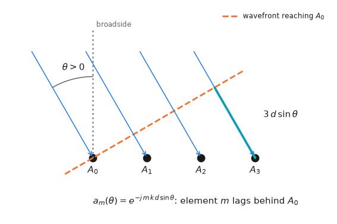
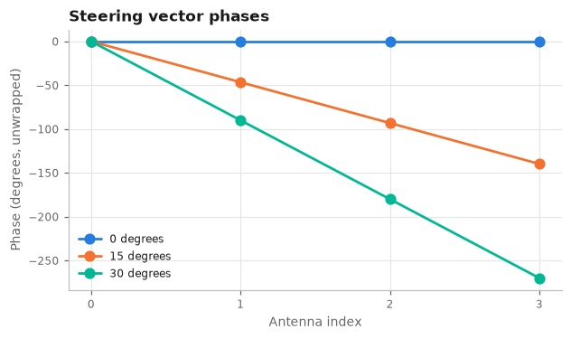
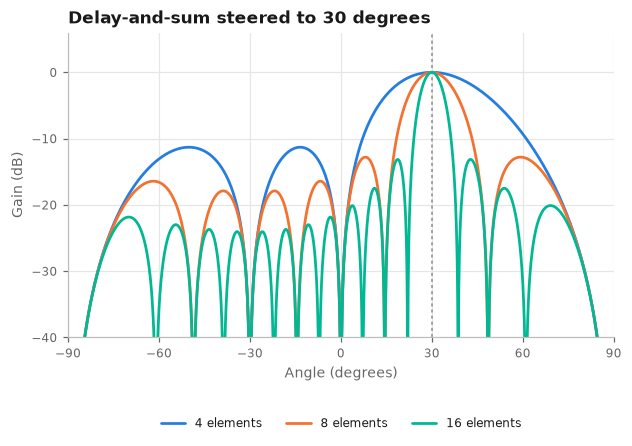

# Beamforming Theory

How the deterministic part of the project works, and which file implements it.
Adaptive weights are in [adaptive_algorithms.md](adaptive_algorithms.md), direction finding in
[doa_estimation.md](doa_estimation.md). The complete derivations are in `beamforming_course.pdf`.

## Introduction

Beamforming is a signal processing technique used with antenna arrays to:

- enhance signals coming from a desired direction,
- attenuate interference,
- improve signal-to-noise ratio (SNR),
- increase spatial selectivity.

It is used in radar, wireless communications, satellite communications, passive RF sensing
and 5G/6G networks. This project is receive-only.

## Conventions

These hold in every file of the repository, and `tests/test_conventions.py` enforces them.

| Item | Convention |
|---|---|
| Snapshot matrix | $\mathbf X\in\mathbb C^{N\times K}$: antennas × snapshots |
| Output | $y=\mathbf w^H\mathbf x$ |
| Angle | from broadside, positive toward $-x$ (drawn to the left) |
| ULA steering vector | $a_m(\theta)=e^{-j\,m\,k\,d\sin\theta}$, $k=2\pi/\lambda$ |
| Covariance | $\hat{\mathbf R}=\mathbf X\mathbf X^H/K$ |
| Noise power | $E\lvert n\rvert^2$, half in each quadrature |

A wave from $\theta>0$ reaches element 0 first; element $m$ receives it later by
$m\,d\sin\theta/c$, hence the minus sign. Changing that sign in one module but not in another
mirrors every angle without raising any error. That is exactly what happened before Phase 1
([audit D1](../PROJECT_AUDIT.md)).

## Antenna arrays

| Geometry | File | Coverage | Shift-invariant |
|---|---|---|---|
| Uniform linear (ULA) | `simulations/antenna_array/linear_array.py` | ±90°, front/back ambiguous | yes |
| Uniform circular (UCA) | `simulations/antenna_array/circular_array.py` | 360° | no |

Elements are modelled as isotropic, identical and uncoupled. Real elements are none of these;
see [hardware requirements](../hardware/requirements.md).

For any planar geometry `dsp/steering.py` uses

$$
a_m(\theta)=\exp\!\big(-jk\,(x_m\sin\theta-y_m\cos\theta)\big)
$$

which reduces to the ULA formula when $y_m=0$.

**Spacing.** $d\le\lambda/2$ avoids grating lobes over the whole sector. `PipelineConfig`
refuses larger spacings because angles would be ambiguous.

**Narrowband assumption.** A delay is replaced by a phase, which requires
$B\,(N-1)d/c\ll1$. The measured cost of violating it is in the
[error budget](../hardware/error_budget_results.md): with four elements a 1 % fractional
bandwidth (24 MHz at 2.4 GHz) already limits a null to about −50 dB.

## Steering vector

$$
\mathbf{a}(\theta)=
\begin{bmatrix}
1 & e^{-jkd\sin\theta} & e^{-j2kd\sin\theta} & \cdots & e^{-j(N-1)kd\sin\theta}
\end{bmatrix}^T
$$

Example, with $N=4$, $d=\lambda/2$, $\theta=30°$: $\mathbf a=[1,-j,-1,j]^T$.

## Beam pattern and metrics

The response of weights $\mathbf w$ is $B(\theta)=\mathbf w^H\mathbf a(\theta)$.
`dsp/signal_metrics.py` computes:

| Metric | Definition | Uniform 8-element reference (tested) |
|---|---|---|
| Half-power beamwidth | −3 dB width of $\lvert B\rvert^2$ | 12.8° at broadside |
| Peak sidelobe | highest secondary maximum | −12.8 dB |
| White noise gain | $\lvert\mathbf w^H\mathbf a\rvert^2/\lVert\mathbf w\rVert^2\le N$ | 8 (9.03 dB) |
| Null depth | response toward the null relative to the target | – |
| Output SINR | $\sigma_s^2\lvert\mathbf w^H\mathbf a\rvert^2/\mathbf w^H\mathbf R_{i+n}\mathbf w$ | – |
| Optimum SINR | $\sigma_s^2\,\mathbf a^H\mathbf R_{i+n}^{-1}\mathbf a\le N\cdot\mathrm{SNR}$ | – |

The last bound is the sanity check for any claimed result: no weights can beat it.

## Delay-and-Sum

| | |
|---|---|
| Formula | $\mathbf w=\mathbf a(\theta_0)/N$ |
| Assumptions | known direction, calibrated channels, spatially white noise |
| Implementation | `dsp.adaptive_weights.das_weights`, `simulations/beamforming/delay_and_sum.py`, C: `abf_das_weights` |
| Complexity | $N$ complex products per output sample, no adaptation |
| Advantages | maximum white noise gain; nothing to estimate; cannot diverge |
| Limitations | −13 dB sidelobes whatever the environment |
| Validation | peak at the steered angle for linear and circular arrays, beamwidth and sidelobe against textbook values, C against Python |

## Null steering

| | |
|---|---|
| Formula | $\mathbf w=\mathbf C(\mathbf C^H\mathbf C)^{-1}\mathbf f$ with $\mathbf C=[\mathbf a(\theta_0),\mathbf a(\theta_1),\dots]$, $\mathbf f=[1,0,\dots]^T$ |
| Assumptions | interferer directions known, channels calibrated |
| Implementation | `null_steering_weights`, `simulations/beamforming/null_steering.py` (up to $N-1$ nulls) |
| Complexity | $O(NL^2+L^3)$ per update for $L$ constraints |
| Advantages | exact nulls, no data needed |
| Limitations | null depth limited by calibration: −43 dB for 1° RMS and −23 dB for 10° RMS (4 elements, simulated); noise amplification for nulls inside the main lobe |
| Validation | constraints met to 1e-12, coincident directions refused, depth against phase and gain errors |

## Choosing the beamformer

| Situation | Choice |
|---|---|
| Noise-limited, or nothing is known | Delay-and-Sum |
| Interferer direction known, few snapshots | Null steering |
| Unknown interference, enough snapshots | [MVDR with loading](adaptive_algorithms.md) |
| Pointing uncertainty and strong target | [LCMV with derivative constraint](adaptive_algorithms.md) |
| Known reference signal | [NLMS or RLS](adaptive_algorithms.md) |

## References

H. L. Van Trees, *Optimum Array Processing*, Wiley, 2002.
D. H. Johnson and D. E. Dudgeon, *Array Signal Processing*, Prentice Hall, 1993.
