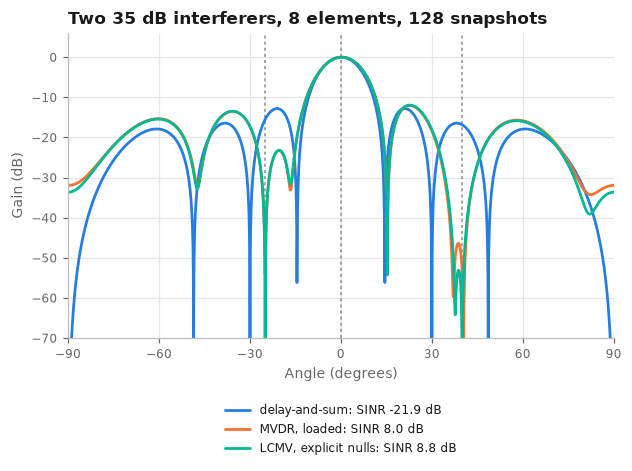

# Course Errata

Findings about `beamforming_course.pdf` (and its French version `cours_beamforming.pdf`) made
while implementing it. The LaTeX sources are not in this repository, so the PDFs are unchanged.

Reproduce everything with:

```bash
python scripts/check_course_errata.py
```

| ID | Where | Problem | What the repository does |
|---|---|---|---|
| E1 | Listings 16.1, C.1 | `esprit(tls=True)` calls `svd(..., full_matrices=False)` | uses the full SVD |
| E2 | §24.8, results table | SINR values above the theoretical maximum | reports computed values |
| E3 | Listing 24.1 | counts sources on the loaded covariance | MDL on the raw covariance |
| E4 | Listing 24.1 | takes the largest spectrum samples, not peaks | local maxima, or root-MUSIC |
| E5 | Listing 22.1 | averages snapshots | principal eigenvector (§22.2.3) |
| E6 | Appendix C.1 | refers to `scripts/generate_figures.py`, absent | the script now exists |
| E7 | Listing 23.1 | derivative constraint referenced to element 0 | referenced to the array centre |

## E1 — TLS-ESPRIT fails when 2L > N − 1

The SVD of the $(N-1)\times2L$ matrix must return all $2L$ right singular vectors. In reduced mode
it returns only $N-1$ of them and the block $V_{22}$ is not square. Observed: `LinAlgError` for
$(N,L)=(4,2),(6,3),(8,4)$; works for $(8,3)$. Fix: `full_matrices=True`.

## E2 — SINR above the physical bound

The scene is $N=8$, SNR 0 dB per antenna, two 35 dB interferers. For any weights,
$\mathrm{SINR}\le N\cdot\mathrm{SNR}=9.03$ dB; the exact optimum for this scene is **8.79 dB**. The table
prints 18 dB (MVDR), 22 dB (LCMV) and 20 dB (robust LCMV). Values measured with this code
(128 snapshots, seed 1, loading 1e-3): Delay-and-Sum −21.9 dB, MVDR 8.0 dB, LCMV 8.8 dB. The
*hierarchy* in the book is right.



## E3 — Source counting on a loaded covariance

Loading is $10^{-2}\,\mathrm{tr}(\mathbf R)/N$. With two 35 dB interferers this is about 63 times the
noise, so the target eigenvalue no longer stands out: the listing finds $L=2$ in 200 trials out
of 200. It then places `L - 1 = 1` explicit null, and the second interferer never gets one
(the loaded covariance still attenuates it).

## E4 — Grid samples instead of peaks

`np.argsort(spec)[::-1]` sorts samples. With sources of unequal strength, the runner-up sample is
the neighbour of the main peak: for peaks at 40.1° and −25° the listing returns 40.00° and 40.25°.

## E5 — Calibration by averaging

The mean of the snapshots vanishes for a modulated source. Simulated residual with 1024
snapshots at 20 dB: 0.10° RMS for a constant source, 1.43° for a modulated one, against 0.11°
with the eigenvector method in both cases.

## E7 — Phase origin of the derivative constraint

With $\dot a_m\propto m\,a_m$ the constraint $\mathbf w^H\dot{\mathbf a}=0$ also fixes the phase centre at element 0.
Minimum-norm weights: white noise gain 3.80 dB instead of 9.03 dB for $N=8$. Replacing
$\dot{\mathbf a}$ by $\dot{\mathbf a}-\mathbf a(\mathbf a^H\dot{\mathbf a})/N$ gives the same flat main lobe at no cost.

## Not an error, but a caution

§10.9 and §23.10 quote the RMB rule (3 dB loss at $K=2N$). It assumes snapshots **without** the
target. With a 0 dB target in the data the loss at $K=2N=16$ is about 8 dB
([figure](adaptive_algorithms.md#mvdr--capon)).
