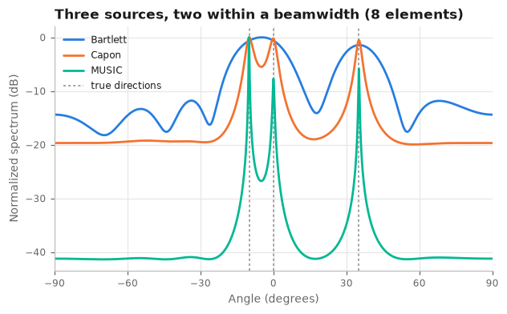
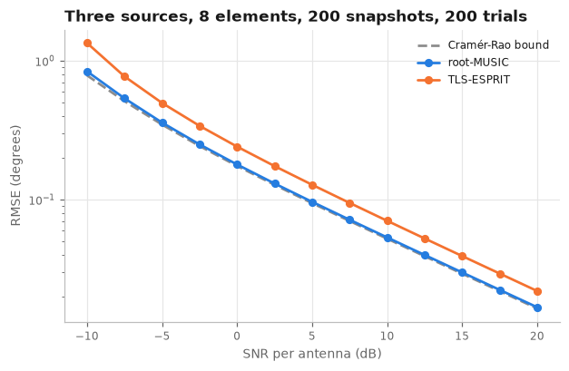
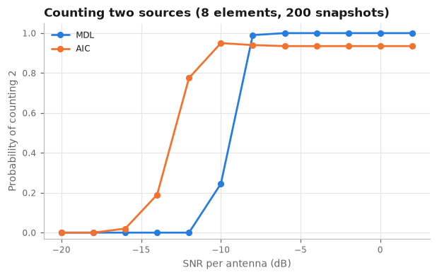
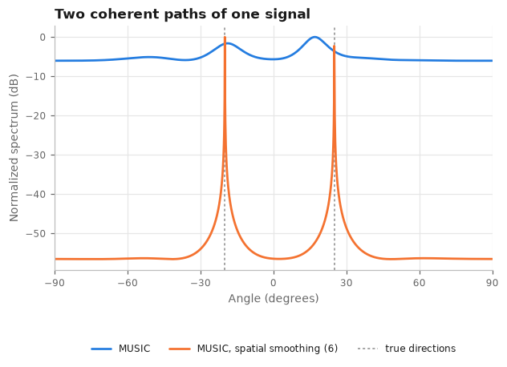

# Direction-of-Arrival Estimation

Model: $\mathbf x=\mathbf A\mathbf s+\mathbf n$, hence
$\mathbf R=\mathbf A\mathbf R_s\mathbf A^H+\sigma^2\mathbf I$. With $L<N$ uncorrelated sources, the $L$ largest
eigenvalues belong to the signal subspace and the $N-L$ others equal $\sigma^2$. Steering vectors
of the sources are orthogonal to the noise subspace $\mathbf U_n$: everything below uses this.

Conventions and steering vectors: [beamforming.md](beamforming.md). All results are simulations.

| Algorithm | File | Needs a ULA | Needs $L$ | Grid |
|---|---|---|---|---|
| Bartlett | `simulations/doa/capon.py` | no | no | yes |
| Capon | `simulations/doa/capon.py` | no | no | yes |
| MUSIC | `simulations/doa/music.py` | no | yes | yes |
| root-MUSIC | `simulations/doa/music.py` | yes | yes | no |
| LS/TLS-ESPRIT | `simulations/doa/esprit.py` | yes | yes | no |
| MDL / AIC | `simulations/doa/order_estimation.py` | no | estimates it | – |
| Cramér–Rao bound | `simulations/doa/crb.py` | no | yes | – |

## Bartlett and Capon

1. **Foundation.** Power of a beam scanned over angle: conventional
   $P_B=\mathbf a^H\mathbf R\mathbf a/N^2$; minimum variance $P_C=1/(\mathbf a^H\mathbf R^{-1}\mathbf a)$.
2. **Assumptions.** Calibrated array; Capon also needs an invertible $\mathbf R$ ($K\ge N$ or loading).
3. **Implementation.** Vectorised over the grid; Capon solves once for all angles.
4. **Complexity.** $O(N^2G)$ for $G$ grid points, plus $O(N^3)$ for Capon.
5. **Advantages.** True power estimates: both give $\sigma_s^2+\sigma^2/N$ for one source.
   **Limitations.** Resolution of one beamwidth for Bartlett; Capon improves with SNR.
6. **Validation.** Calibrated power tested; Bartlett does not resolve two sources 8° apart with
   a 12.8° beam while MUSIC does.

## MUSIC and root-MUSIC

1. **Foundation.** $P_M(\theta)=N/\lVert\mathbf U_n^H\mathbf a(\theta)\rVert^2$. Root-MUSIC finds the roots of
   $\mathbf a^T(1/z)\mathbf U_n\mathbf U_n^H\mathbf a(z)$, $z=e^{-jkd\sin\theta}$, nearest the unit circle.
2. **Assumptions.** $L<N$ known; sources not fully coherent; calibrated manifold; white noise.
3. **Implementation.** `music_spectrum`, `root_music`. Roots come in conjugate-reciprocal pairs;
   the inner one of each pair is kept, which is robust when noise-free roots fall on the circle.
4. **Complexity.** One $O(N^3)$ eigendecomposition, then $O(N(N-L)G)$ for the grid or an
   eigenvalue problem of size $2N-2$ for root-MUSIC.
5. **Advantages.** Resolution not limited by the beamwidth; root-MUSIC needs no grid.
   **Limitations.** Peaks carry no power information; fails with coherent paths.
6. **Validation.** Exact without noise for six $(N,L)$ pairs; root-MUSIC RMSE within 6 % of the
   Cramér–Rao bound from −5 to 20 dB SNR.

## ESPRIT

1. **Foundation.** The first and last $N-1$ elements of a ULA see the same sources up to
   $\mathbf\Phi=\mathrm{diag}(e^{-jkd\sin\theta_i})$: $\mathbf U_{s2}=\mathbf U_{s1}\mathbf\Psi$, and $\mathbf\Psi$ has the
   eigenvalues of $\mathbf\Phi$.
2. **Assumptions.** Exact shift invariance, so a calibrated ULA; $L$ known.
3. **Implementation.** `esprit(R, L, tls=True)`. TLS uses a *full* SVD: the course listing uses a
   reduced one and fails when $2L>N-1$ ([erratum E1](course_errata.md)).
4. **Complexity.** $O(N^3)+O(L^3)$, no grid: the cheapest high-resolution option.
5. **Advantages.** Fast, automatic. **Limitations.** About 1.3–1.45 times the RMSE of root-MUSIC
   here; sensitive to calibration.
6. **Validation.** Exact without noise including the sizes that break the course listing;
   Monte-Carlo against the bound.

## Counting sources

MDL and AIC test how many of the smallest eigenvalues are equal (Wax and Kailath, 1985).

AIC is more sensitive but keeps a constant overestimation rate; MDL is the pipeline default.
**Apply them to the unloaded covariance.** Loading flattens the small eigenvalues: on the
course's own scene the loaded test finds 2 sources out of 3 in 200 trials out of 200, MDL on
the raw covariance finds 3 in 200 out of 200 ([erratum E3](course_errata.md)).

## Coherent multipath

Two paths of one signal make $\mathbf R_s$ rank 1 and the subspaces no longer separate. Spatial
smoothing over $N-M+1$ subarrays of $M$ elements, with forward-backward averaging, restores the
rank at the price of aperture.

## Peak extraction

`find_spectrum_peaks` returns local maxima, refined by a parabola on the log-spectrum. Taking
the largest samples instead returns neighbours of one peak
([erratum E4](course_errata.md)).

## Detection

`simulations/scenarios/interference_detection.py` compares the largest eigenvalue with the mean
of the others. The threshold is set by Monte-Carlo for a false-alarm rate. With $N=4$, $K=128$
and a 1 % target: measured false-alarm rate 0.6 % over 3000 trials; detection probability 8 %
at −12 dB, 58 % at −9 dB, 100 % at −6 dB and above (500 trials). It is insensitive to a common
gain change, but per-channel noise imbalance looks like a source.

## References

R. O. Schmidt, *IEEE Trans. AP* 34(3), 276–280, 1986.
R. Roy, T. Kailath, *IEEE Trans. ASSP* 37(7), 984–995, 1989, doi:10.1109/29.32276.
M. Wax, T. Kailath, *IEEE Trans. ASSP* 33(2), 387–392, 1985, doi:10.1109/TASSP.1985.1164557.
T.-J. Shan, M. Wax, T. Kailath, *IEEE Trans. ASSP* 33(4), 806–811, 1985,
doi:10.1109/TASSP.1985.1164649.
P. Stoica, A. Nehorai, *IEEE Trans. ASSP* 37(5), 720–741, 1989.
