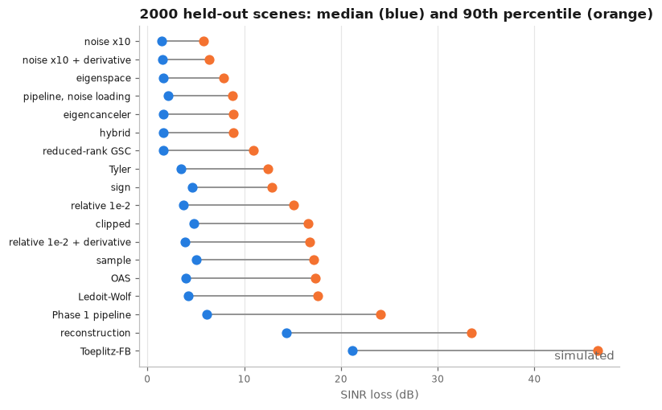
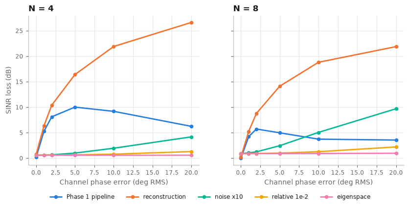

# Study 1 — Covariance estimation for adaptive beamforming

**Simulation only.** Hypotheses: [HYPOTHESES.md](../HYPOTHESES.md). Reproduce:

```bash
python -m research.covariance.run
python -m research.covariance.report
```

## Summary

1. **Noise-referenced loading is the recommended default.** MVDR with a loading of 10 to 30 times the
   estimated noise has the smallest 90th-percentile loss on 2 × 2000 held-out random scenes: 5.1–5.8 dB,
   against 15 dB for the relative loading used so far and **23–24 dB for the Phase 1 pipeline**.
2. **The Phase 1 pipeline is fragile.** Its explicit nulls use the nominal manifold. At 40 dB INR, 1° of
   channel error takes its loss from 0.2 to 5.3 dB (N = 4), where plain loaded MVDR stays at 0.6 dB.
   With perfect calibration and few snapshots it is the best method of all; that is not a situation
   hardware provides.
3. **Covariance reconstruction, ranked first in the preliminary roadmap, is not usable without
   near-perfect calibration**: best with no error, worst of all methods from 1° on.
4. **Known weakness of the recommendation.** The held-out scenes have targets up to 10 dB. With a 20 dB
   target and a pointing error, noise-referenced loading self-cancels: 19 dB of loss at 1° with
   N = 8, where eigenspace projection loses 4 dB. Its worst-case regret over all experiments is 30 dB.
   Strong, badly pointed targets need another method.
5. **Shrinkage (Ledoit–Wolf, OAS) and Tyler do not help here.** The first scale with the interferer, the
   second fails badly with pulsed interference.
6. A hybrid designed by the author after seeing the first results **lost** to the simplest candidate on
   held-out scenes. It would have been recommended without that check.

## 1. Theory

MVDR weights depend on an estimate $\hat{\mathbf R}$ of the covariance. With $K$ snapshots the sample
covariance $\mathbf S$ has an error of relative order $\sqrt{N/K}$, and three mechanisms turn it into SINR
loss: noise eigenvalues spread (bad weights in the noise subspace); the target, present in the data, is
partly cancelled; and model errors (pointing, channels) make the target look like interference.

| Family | Idea | Estimator |
|---|---|---|
| Loading | raise all eigenvalues | $\mathbf S+\alpha\mathbf I$ with $\alpha=10^{-2}\,\mathrm{tr}(\mathbf S)/N$ (baseline) or $\alpha=c\,\hat\sigma^2$ |
| Shrinkage | minimise $E\lVert\hat{\mathbf R}-\mathbf R\rVert_F^2$ | Ledoit–Wolf, OAS |
| Structure | use Toeplitz and centro-Hermitian symmetry | Toeplitz-FB |
| Spectrum cleaning | raise eigenvalues to the noise floor | clipped (fast maximum likelihood) |
| Robust statistics | down-weight strong snapshots | sign covariance, regularised Tyler |
| Subspace | trust only dominant eigenvectors | eigenspace, eigencanceler, reduced-rank GSC |
| Manifold | rebuild interference from its spectrum | reconstruction |

**OAS for complex data.** The published OAS intensity is derived for real Gaussian data. For circular
complex data $E\,\mathrm{tr}(\mathbf S^2)=\mathrm{tr}(\mathbf R^2)+\mathrm{tr}^2(\mathbf R)/K$ and
$E\,\mathrm{tr}^2(\mathbf S)=\mathrm{tr}^2(\mathbf R)+\mathrm{tr}(\mathbf R^2)/K$. Minimising
$E\lVert(1-\rho)\mathbf S+\rho\frac{\mathrm{tr}\mathbf S}{N}\mathbf I-\mathbf R\rVert_F^2$ gives

$$
\rho^\star=\frac{t_1-t_2/N}{(K-1/N)\,t_2+(1-K/N)\,t_1},\qquad t_1=\mathrm{tr}^2(\mathbf R),\; t_2=\mathrm{tr}(\mathbf R^2).
$$

Replacing $\mathbf R$ by the estimate and iterating converges to the closed form used here,

$$
\hat\rho=\min\!\left(1,\frac{\hat t_1-\hat t_2/N}{(K-1/N)(\hat t_2-\hat t_1/N)}\right).
$$

Tests verify the moment by simulation, that $\rho^\star$ minimises the Monte-Carlo error, and that OAS and
Ledoit–Wolf beat $\mathbf S$ in Frobenius error. They do. That is not the same as SINR.

## 2. Hypotheses and verdicts

| ID | Verdict | Evidence |
|---|---|---|
| H1.1 noise loading ≤ 1 dB for K ≥ 4N | **refuted**, narrowly | 1.02 dB, interval 0.91–1.13, at N = 4, K = 16, INR 20–60; every other point complies |
| H1.2 shrinkage loses ≥ 1 dB to noise loading at 60 dB | **criterion met**, statement partly wrong | +14.5 / +15.3 dB (N=4), +5.5 / +5.7 dB (N=8); but the loss is not monotonic in INR at N = 8 |
| H1.3 reconstruction wins by ≥ 0.5 dB at 2°, loses beyond 5° | **refuted** | wins by 0.46 dB (N = 4, under the criterion) and 1.05 dB (N = 8); but the advantage is already lost at 1° of channel error, not 5° |
| H1.4 Tyler gains ≥ 1 dB in heavy tails | **refuted** | −1.15 to +0.12 dB against the same loading; collapses with pulsed interference |
| H1.5 cost | **refuted** | reconstruction 2.0–2.2 × (not ≥ 5); noise loading 2.9 × at N = 4 but 3.9 × at N ≥ 8 |
| H1.6 best DOA-free method within 0.5 dB of the pipeline, nominal | supported | at most 0.26 dB worse at INR 40 dB, and better at K = N; the DOA-free method that achieves it is reconstruction, with perfect calibration |
| H1.7 eigencanceler ≤ 1 dB up to 10° | **refuted** at N = 8 | 1.04–1.26 dB at six of the ten N = 8 points; ≤ 0.7 dB at every N = 4 point |
| H1.8 noise loading rescues the pipeline by ≥ 3 dB | **refuted** | 0.95 to 5.2 dB; ≥ 3 dB at two of six points |
| H1.9 reduced-rank GSC ≤ 1.5 dB at K = N | **refuted** | 3.4 dB |
| H1.10 no method within 1 dB of the best everywhere | supported | smallest worst-case regret: 8.8 dB (eigencanceler) |
| H1.11 hybrid is best on held-out scenes | **refuted** | p90 8.9 dB against 5.8 dB for noise × 10 |
| H1.12 pipeline p90 ≥ 5 dB on held-out scenes | supported | 24.0 dB |
| H1.13 tuned factor gains ≥ 1 dB | **refuted** | 0.5 dB (factor 30); the optimum is flat from 10 to 100 |

H1.3 to H1.5, H1.7 to H1.9, H1.11 and H1.13 were the author's expectations and were wrong. Two
of them (H1.3, H1.11) would have led to the wrong design.

## 3. Experiment

`run.py`: 200 paired scenes per point (2000 for held-out), fixed seeds, interferer at −25° unless stated,
target in the data, K = 256 unless stated. Methods only know the nominal manifold and target direction.

## 4. Metrics

Loss = optimum SINR of the true scene minus achieved SINR; means are on linear ratios. The result files
hold 95 % bootstrap intervals and the worst decile. Held-out scenes report median, 90th and 99th
percentiles: averages hide the failures that matter. A numerical failure counts as zero output.

## 5. Baselines

Sample MVDR, relative loading 1e-2 (Phase 1 default), and the frozen Phase 1 pipeline itself, run
unmodified.

## 6. Results

### Held-out scenes

Random angles, powers, errors and noise; definition in HYPOTHESES.md.

<!-- held_out -->

| method | median | p90 | p99 | > 10 dB |
|---:|---:|---:|---:|---:|
| noise x10 | 1.44 | 5.76 | 12.4 | 2.2 % |
| noise x10 + derivative | 1.57 | 6.36 | 13.4 | 2.6 % |
| eigenspace | 1.66 | 7.89 | 29.6 | 6.3 % |
| pipeline, noise loading | 2.14 | 8.83 | 19.3 | 7.4 % |
| eigencanceler | 1.68 | 8.84 | 35.1 | 8.1 % |
| hybrid | 1.67 | 8.91 | 37.6 | 8.4 % |
| reduced-rank GSC | 1.64 | 10.97 | 28.5 | 11.5 % |
| Tyler | 3.43 | 12.42 | 22.0 | 15.8 % |
| sign | 4.64 | 12.90 | 21.7 | 18.9 % |
| relative 1e-2 | 3.70 | 15.08 | 23.9 | 21.6 % |
| clipped | 4.76 | 16.62 | 28.8 | 24.7 % |
| relative 1e-2 + derivative | 3.90 | 16.80 | 31.0 | 24.9 % |
| sample | 5.01 | 17.17 | 29.7 | 26.1 % |
| OAS | 3.98 | 17.38 | 28.8 | 25.8 % |
| Ledoit-Wolf | 4.18 | 17.59 | 28.8 | 27.2 % |
| Phase 1 pipeline | 6.16 | 24.04 | 33.2 | 36.7 % |
| reconstruction | 14.34 | 33.44 | 42.1 | 59.2 % |
| Toeplitz-FB | 21.18 | 46.53 | 63.2 | 66.8 % |
| delay-and-sum | 33.30 | 48.71 | 54.5 | 85.0 % |

<!-- /held_out -->



### Loading factor, second held-out set

The factor was chosen on a separate design set (30 without derivative).

<!-- held_out_2 -->

| method | median | p90 | p99 | > 10 dB |
|---:|---:|---:|---:|---:|
| noise x30 | 1.55 | 5.12 | 9.3 | 0.5 % |
| noise x10 | 1.43 | 5.64 | 12.9 | 2.5 % |
| noise x100 | 2.01 | 6.38 | 10.5 | 1.7 % |
| noise x10 + derivative | 1.63 | 6.57 | 12.6 | 2.9 % |
| noise x3 + derivative | 1.83 | 6.98 | 12.3 | 3.0 % |
| noise x30 + derivative | 1.81 | 7.12 | 15.4 | 4.9 % |
| eigenspace | 1.53 | 7.81 | 26.9 | 7.0 % |
| noise x1 + derivative | 2.30 | 7.87 | 14.9 | 4.5 % |
| noise x100 + derivative | 2.39 | 8.70 | 20.2 | 8.1 % |
| noise x3 | 1.87 | 8.88 | 19.9 | 8.0 % |
| noise x300 | 3.17 | 8.89 | 14.5 | 6.6 % |
| hybrid | 1.62 | 10.00 | 39.9 | 10.0 % |
| noise x300 + derivative | 3.68 | 11.44 | 24.2 | 13.0 % |
| noise x1 | 2.74 | 12.55 | 25.5 | 14.8 % |
| noise x1000 | 5.43 | 12.61 | 19.6 | 21.3 % |
| noise x1000 + derivative | 5.98 | 15.13 | 28.4 | 27.1 % |
| relative 1e-2 | 3.80 | 15.14 | 22.9 | 23.9 % |
| Phase 1 pipeline | 6.45 | 23.11 | 34.6 | 38.6 % |

<!-- /held_out_2 -->

With N = 8 the derivative constraint helps at low factors (p90 5.96 dB at factor 10 against 7.46) and
with N = 4 it hurts (7.42 against 3.25): it costs a degree of freedom that four antennas do not have.

### Snapshots and interferer level (SINR loss in dB, 0 dB target)

<!-- snapshots -->

| scene | sample | relative 1e-2 | Phase 1 pipeline | pipeline, noise loading | noise x10 | OAS | Ledoit-Wolf | Toeplitz-FB | Tyler | eigenspace | eigencanceler | reconstruction |
|---:|---:|---:|---:|---:|---:|---:|---:|---:|---:|---:|---:|---:|
| N=8 K=2N INR=20 | 7.93 | 3.38 | 2.00 | **0.14** | 1.73 | 1.77 | 1.84 | 0.35 | 4.11 | 1.89 | 1.69 | 0.31 |
| N=8 K=4N INR=20 | 4.98 | 2.04 | 1.18 | **0.07** | 0.88 | 1.11 | 1.12 | 0.18 | 2.58 | 0.94 | 0.85 | 0.29 |
| N=8 K=32N INR=20 | 0.96 | 0.34 | 0.19 | **0.02** | 0.14 | 0.55 | 0.52 | **0.04** | 0.47 | 0.14 | 0.14 | 0.29 |
| N=8 K=2N INR=40 | 7.93 | 1.64 | **0.02** | 0.14 | 1.76 | 1.84 | 1.83 | 2.33 | 2.08 | 1.89 | 1.65 | 0.28 |
| N=8 K=4N INR=40 | 4.98 | 0.84 | **0.01** | 0.07 | 0.88 | 0.93 | 0.93 | 1.68 | 1.09 | 0.94 | 0.83 | 0.26 |
| N=8 K=32N INR=40 | 0.96 | 0.13 | **0.01** | **0.02** | 0.13 | 0.12 | 0.12 | 0.68 | 0.18 | 0.14 | 0.12 | 0.25 |
| N=8 K=2N INR=60 | 7.93 | 2.17 | **0.02** | 0.14 | 1.76 | 12.13 | 9.84 | 4.64 | 2.93 | 1.89 | 1.65 | 0.27 |
| N=8 K=4N INR=60 | 4.98 | 1.72 | **0.01** | 0.07 | 0.88 | 6.60 | 6.39 | 4.00 | 1.96 | 0.94 | 0.83 | 0.26 |
| N=8 K=32N INR=60 | 0.96 | 1.35 | **0.01** | **0.02** | 0.13 | 0.32 | 0.39 | 3.14 | 0.41 | 0.14 | 0.12 | 0.25 |
| N=4 K=4N INR=20 | 2.88 | 1.48 | 0.73 | **0.46** | 1.02 | 1.02 | 1.04 | **0.49** | 1.83 | 1.29 | 1.02 | 0.60 |
| N=4 K=32N INR=20 | 0.46 | 0.23 | 0.28 | 0.25 | 0.18 | 0.24 | 0.22 | **0.10** | 0.30 | 0.18 | 0.17 | 0.52 |
| N=4 K=4N INR=60 | 2.87 | 3.14 | 0.56 | **0.46** | 1.02 | 16.29 | 15.51 | 3.73 | 2.53 | 1.30 | 1.00 | 0.54 |
| N=4 K=32N INR=60 | 0.46 | 2.82 | 0.26 | 0.24 | **0.16** | 1.98 | 2.90 | 2.78 | 0.75 | **0.18** | **0.15** | 0.51 |

<!-- /snapshots -->

### Channel errors (10 dB target, INR 40 dB)

Phase error RMS, with 0.1 dB of gain error per degree.

<!-- calibration -->

| scene | sample | relative 1e-2 | Phase 1 pipeline | pipeline, noise loading | noise x10 | OAS | Ledoit-Wolf | Toeplitz-FB | Tyler | eigenspace | eigencanceler | reconstruction |
|---:|---:|---:|---:|---:|---:|---:|---:|---:|---:|---:|---:|---:|
| N=4 phase=0 pointing=0 | 1.50 | 0.60 | **0.23** | **0.23** | 0.57 | 0.57 | 0.58 | 1.84 | 0.80 | 0.56 | 0.56 | 0.77 |
| N=4 phase=1 pointing=0 | 2.33 | **0.61** | 5.26 | 4.31 | **0.60** | **0.59** | **0.59** | 7.67 | 0.79 | **0.57** | **0.58** | 6.32 |
| N=4 phase=2 pointing=0 | 3.93 | **0.62** | 8.11 | 5.29 | 0.66 | **0.60** | **0.60** | 10.29 | 0.81 | **0.57** | **0.58** | 10.39 |
| N=4 phase=5 pointing=0 | 8.24 | 0.66 | 10.01 | 4.86 | 1.00 | 0.67 | 0.65 | 13.90 | 0.89 | **0.57** | **0.60** | 16.41 |
| N=4 phase=10 pointing=0 | 13.07 | 0.79 | 9.19 | 3.93 | 1.95 | 0.91 | 0.85 | 16.38 | 1.16 | **0.57** | 0.66 | 21.91 |
| N=8 phase=0 pointing=0 | 4.85 | 0.88 | **0.01** | 0.07 | 0.93 | 0.87 | 0.87 | 2.30 | 1.18 | 0.87 | 0.88 | 0.25 |
| N=8 phase=1 pointing=0 | 6.76 | **0.91** | 4.23 | 2.26 | 1.03 | **0.92** | **0.91** | 10.01 | 1.21 | **0.90** | **0.91** | 5.25 |
| N=8 phase=2 pointing=0 | 9.84 | **0.92** | 5.72 | 2.32 | 1.25 | **0.95** | **0.94** | 14.20 | 1.26 | **0.90** | **0.92** | 8.79 |
| N=8 phase=5 pointing=0 | 16.51 | 1.00 | 4.98 | 2.84 | 2.45 | 1.15 | 1.12 | 20.13 | 1.62 | **0.91** | **0.94** | 14.11 |
| N=8 phase=10 pointing=0 | 22.42 | 1.27 | 3.73 | 4.64 | 5.06 | 1.79 | 1.68 | 22.34 | 2.65 | **0.92** | 1.04 | 18.81 |

<!-- /calibration -->



### Pointing error (INR 40 dB)

<!-- pointing -->

| scene | sample | relative 1e-2 | Phase 1 pipeline | pipeline, noise loading | noise x10 | OAS | Ledoit-Wolf | Toeplitz-FB | Tyler | eigenspace | eigencanceler | reconstruction |
|---:|---:|---:|---:|---:|---:|---:|---:|---:|---:|---:|---:|---:|
| N=8 SNR=0 error=0 | 0.96 | 0.13 | **0.01** | **0.02** | 0.13 | 0.12 | 0.12 | 0.68 | 0.18 | 0.14 | 0.12 | 0.25 |
| N=8 SNR=0 error=1 | 3.80 | 0.21 | **0.12** | **0.13** | 0.31 | 0.21 | 0.21 | 0.70 | 0.31 | **0.14** | 0.19 | 0.32 |
| N=8 SNR=0 error=2 | 7.85 | 0.43 | 0.36 | 0.37 | 0.84 | 0.48 | 0.47 | 0.89 | 0.69 | **0.14** | 0.38 | 0.49 |
| N=8 SNR=0 error=4 | 13.59 | 1.29 | 1.24 | 1.32 | 2.63 | 1.51 | 1.47 | 1.78 | 2.07 | **0.14** | 1.13 | 1.22 |
| N=8 SNR=10 error=0 | 4.85 | 0.88 | **0.01** | 0.07 | 0.93 | 0.87 | 0.87 | 2.30 | 1.18 | 0.87 | 0.88 | 0.25 |
| N=8 SNR=10 error=1 | 19.95 | 1.06 | **0.12** | 0.19 | 3.53 | 1.34 | 1.28 | 2.46 | 1.97 | 0.88 | 0.94 | 0.32 |
| N=8 SNR=10 error=2 | 25.97 | 1.55 | **0.37** | 0.61 | 7.32 | 2.49 | 2.31 | 3.41 | 3.74 | 0.88 | 1.11 | 0.50 |
| N=8 SNR=10 error=4 | 32.14 | 3.24 | 1.33 | 3.31 | 12.92 | 5.59 | 5.16 | 7.49 | 7.69 | **0.89** | 1.77 | 1.25 |
| N=8 SNR=20 error=0 | 13.03 | 3.92 | **0.02** | 0.54 | 4.26 | 3.94 | 3.93 | 6.19 | 4.71 | 3.91 | 4.04 | 0.25 |
| N=8 SNR=20 error=1 | 39.62 | 5.89 | **0.14** | 1.46 | 19.18 | 9.55 | 8.86 | 10.08 | 11.76 | 3.95 | 4.06 | 0.32 |
| N=8 SNR=20 error=2 | 45.19 | 8.91 | 0.59 | 7.06 | 25.19 | 14.42 | 13.49 | 19.50 | 16.92 | 3.99 | 4.16 | **0.50** |
| N=8 SNR=20 error=4 | 49.65 | 13.85 | 3.50 | 13.85 | 31.60 | 20.46 | 19.43 | 21.54 | 23.07 | 4.13 | 4.59 | **1.25** |

<!-- /pointing -->

### Noise models

<!-- noise -->

| scene | sample | relative 1e-2 | Phase 1 pipeline | pipeline, noise loading | noise x10 | OAS | Ledoit-Wolf | Toeplitz-FB | Tyler | eigenspace | eigencanceler | reconstruction |
|---:|---:|---:|---:|---:|---:|---:|---:|---:|---:|---:|---:|---:|
| N=8 K=32 gaussian INR=10 | 4.99 | 4.22 | 3.16 | **0.07** | 0.82 | 2.65 | 2.63 | 0.16 | 4.49 | 0.93 | 1.07 | 0.30 |
| N=8 K=32 gaussian INR=30 | 4.98 | 0.88 | **0.06** | **0.07** | 0.88 | 0.84 | 0.84 | 0.65 | 1.23 | 0.94 | 0.83 | 0.27 |
| N=8 K=32 student INR=10 | 6.27 | 4.84 | 3.78 | **0.18** | 0.92 | 2.70 | 2.64 | **0.14** | 5.49 | 1.29 | 1.28 | 0.29 |
| N=8 K=32 student INR=30 | 6.27 | 0.88 | **0.08** | 0.18 | 0.98 | 0.85 | 0.84 | 1.23 | 1.21 | 1.29 | 1.00 | 0.27 |
| N=8 K=32 impulsive INR=10 | 9.06 | 5.41 | 4.57 | 0.87 | 1.53 | 2.44 | 2.31 | 0.60 | 6.56 | 2.00 | 1.66 | **0.28** |
| N=8 K=32 impulsive INR=30 | 9.05 | 0.91 | **0.15** | 0.87 | 1.54 | 0.85 | 0.84 | 3.24 | 1.14 | 1.99 | 1.40 | 0.28 |
| N=8 K=256 gaussian INR=10 | 0.96 | 0.80 | 0.59 | **0.02** | 0.20 | 0.86 | 0.85 | 0.13 | 0.90 | 0.14 | 0.30 | 0.29 |
| N=8 K=256 gaussian INR=30 | 0.96 | 0.13 | **0.02** | **0.02** | 0.13 | 0.16 | 0.15 | 0.16 | 0.20 | 0.14 | 0.13 | 0.26 |
| N=8 K=256 student INR=10 | 1.32 | 1.07 | 0.83 | **0.03** | 0.18 | 1.16 | 1.13 | 0.09 | 1.24 | 0.35 | 0.33 | 0.29 |
| N=8 K=256 student INR=30 | 1.32 | 0.13 | **0.02** | **0.03** | 0.14 | 0.18 | 0.17 | 0.23 | 0.19 | 0.35 | 0.16 | 0.26 |
| N=8 K=256 impulsive INR=10 | 2.07 | 1.56 | 1.41 | 0.17 | 0.23 | 1.73 | 1.68 | **0.06** | 1.70 | 1.29 | 0.34 | 0.29 |
| N=8 K=256 impulsive INR=30 | 2.07 | 0.14 | **0.09** | 0.16 | 0.22 | 0.20 | 0.19 | 0.75 | 0.19 | 1.29 | 0.16 | 0.27 |

<!-- /noise -->

### Pulsed interference, many interferers, coherent interference (N = 8)

<!-- special -->

| scene | sample | relative 1e-2 | Phase 1 pipeline | pipeline, noise loading | noise x10 | OAS | Ledoit-Wolf | Toeplitz-FB | Tyler | eigenspace | eigencanceler | reconstruction |
|---:|---:|---:|---:|---:|---:|---:|---:|---:|---:|---:|---:|---:|
| N=8 duty=1.0 | 0.96 | 0.13 | **0.02** | **0.02** | 0.13 | 0.16 | 0.15 | 0.16 | 0.20 | 0.14 | 0.13 | 0.26 |
| N=8 duty=0.1 | 0.92 | 0.17 | **0.02** | **0.01** | 0.17 | 0.20 | 0.30 | 0.16 | 7.92 | 0.17 | 0.16 | 0.26 |
| N=8 duty=0.03 | 0.97 | 0.22 | **0.02** | **0.01** | 0.22 | 0.26 | 2.03 | 0.18 | 18.94 | 0.22 | 0.21 | 0.29 |

| scene | sample | relative 1e-2 | Phase 1 pipeline | pipeline, noise loading | noise x10 | OAS | Ledoit-Wolf | Toeplitz-FB | Tyler | eigenspace | eigencanceler | reconstruction |
|---:|---:|---:|---:|---:|---:|---:|---:|---:|---:|---:|---:|---:|
| N=8 interferers=1 | 0.96 | 0.13 | **0.02** | **0.02** | 0.13 | 0.16 | 0.15 | 0.16 | 0.20 | 0.14 | 0.13 | 0.26 |
| N=8 interferers=3 | 0.87 | 0.40 | **0.15** | **0.14** | 0.38 | 0.45 | 0.45 | 3.64 | 0.46 | 0.39 | 0.38 | 0.29 |
| N=8 interferers=5 | 0.92 | 0.74 | **0.47** | **0.43** | 0.66 | 2.02 | 2.07 | 6.36 | 0.83 | 0.66 | 0.66 | 0.64 |
| N=8 interferers=6 | 0.92 | 1.05 | 1.05 | **0.80** | **0.80** | 3.70 | 3.79 | 5.84 | 1.06 | **0.80** | **0.81** | 1.27 |
| N=8 interferers=7 | **0.67** | 8.25 | 8.25 | 7.61 | 7.61 | 12.14 | 12.17 | 8.04 | 7.57 | 22.69 | 1.38 | 6.68 |

| scene | sample | relative 1e-2 | Phase 1 pipeline | pipeline, noise loading | noise x10 | OAS | Ledoit-Wolf | Toeplitz-FB | Tyler | eigenspace | eigencanceler | reconstruction |
|---:|---:|---:|---:|---:|---:|---:|---:|---:|---:|---:|---:|---:|
| N=8 correlation=0.0 | 0.96 | 0.80 | 0.59 | **0.02** | 0.20 | 0.86 | 0.85 | 0.13 | 0.90 | 0.14 | 0.30 | 0.29 |
| N=8 correlation=0.3 | 2.77 | 2.67 | 0.59 | **0.02** | 1.92 | 2.71 | 2.70 | 0.12 | 2.76 | 2.29 | 2.79 | 0.30 |
| N=8 correlation=0.9 | 8.61 | 8.59 | 0.81 | **0.02** | 7.69 | 8.60 | 8.60 | 0.10 | 8.60 | 8.59 | 8.81 | 0.43 |

<!-- /special -->

Coherent interference defeats every covariance method except those that impose the manifold
(Toeplitz-FB, reconstruction, explicit nulls) — the same ones that calibration errors destroy.

### Computing time

Python, one thread, i7-9700K, K = 256, covariance included. Small-matrix NumPy overhead dominates: these
ratios are not operation counts. See [study 3](../c_port/REPORT.md) for C.

<!-- cost -->

| method | N=4 (us) | N=8 (us) | N=16 (us) | ratio at N=8 |
|---:|---:|---:|---:|---:|
| Ledoit-Wolf | 151 | 184 | 280 | 2.1 |
| OAS | 96 | 118 | 175 | 1.3 |
| Phase 1 pipeline | 1141 | 1410 | 2232 | 16.1 |
| Toeplitz-FB | 366 | 493 | 811 | 5.6 |
| Tyler | 1041 | 1494 | 3278 | 17.0 |
| clipped | 257 | 361 | 672 | 4.1 |
| eigencanceler | 147 | 249 | 464 | 2.8 |
| eigenspace | 129 | 258 | 425 | 2.9 |
| noise x10 | 213 | 341 | 559 | 3.9 |
| noise x10 + derivative | 293 | 393 | 621 | 4.5 |
| pipeline, noise loading | 1310 | 1715 | 2597 | 19.5 |
| reconstruction | 148 | 183 | 310 | 2.1 |
| reduced-rank GSC | 158 | 250 | 524 | 2.9 |
| relative 1e-2 | 74 | 88 | 142 | 1.0 |
| relative 1e-2 + derivative | 122 | 143 | 194 | 1.6 |
| sample | 68 | 81 | 127 | 0.9 |
| sign | 114 | 140 | 213 | 1.6 |

<!-- /cost -->

## 7. Limitations and conclusions

Limitations:

- Simulation with point sources, no coupling, no multipath except the correlation experiment.
- Channel errors are independent per channel and constant over a block.
- Held-out scenes follow one distribution chosen by the author, with SNR ≤ 10 dB; interferers may be close to the main
  lobe (12°), so part of the loss is unavoidable for methods that do not know the manifold exactly.
- The noise estimate uses MDL. It assumes spatially white noise: channel noise imbalance was not tested.
- No steering-vector correction was added to reconstruction, as the original paper does; it might
  recover part of the loss with calibration errors.

Conclusions and what changes in the roadmap:

| Decision | Reason |
|---|---|
| Use MVDR with noise-referenced loading (factor 10–30) as the default of the C pipeline | best tail behaviour; independent of INR |
| Derivative constraint only for N ≥ 8 | degrees of freedom |
| Explicit nulls only with a verified calibration (≤ 0.5°) or with few snapshots | fragility |
| Do not pursue reconstruction, shrinkage or Tyler further in their present form | results above |
| Not for strong targets with uncertain direction: use the derivative constraint and higher loading, or eigenspace projection | self-cancellation above |
| Eigenspace projection is the method to study next for strong targets with pointing errors | loss nearly independent of pointing and channel errors (0.57–0.98 dB), but fails when sources saturate the array |
| The Phase 1 baseline stays frozen; its weakness is documented here | rule of Phase 2 |

## References

Checked by web search in the roadmap unless noted †, which are cited from memory of the standard
literature and must be verified before publication.

- Y. Gu, A. Leshem, 2012 (reconstruction).
- † O. Ledoit, M. Wolf, "A well-conditioned estimator for large-dimensional covariance matrices",
  *J. Multivariate Analysis*, 2004.
- † Y. Chen, A. Wiesel, Y. C. Eldar, A. O. Hero, "Shrinkage algorithms for MMSE covariance estimation",
  *IEEE Trans. Signal Processing*, 2010.
- † D. E. Tyler, "A distribution-free M-estimator of multivariate scatter", *Annals of Statistics*, 1987.
- † A. M. Haimovich, Y. Bar-Ness, "An eigenanalysis interference canceler", *IEEE Trans. Signal
  Processing*, 1991.
