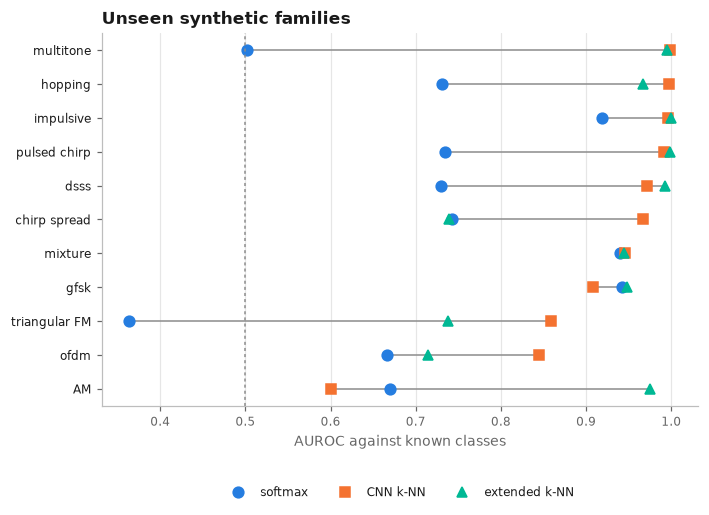

# Study 2 — Detecting unknown waveforms

Training data are synthetic. Tests use synthetic families written independently of the training code
**and real recordings** made by third parties with RTL-SDR receivers. No signal was received by the
author. Hypotheses: [HYPOTHESES.md](../HYPOTHESES.md).

```bash
python -m ai.training.train                  # Phase 1 checkpoint
python -m research.open_set.recordings       # about 20 MB, verified by hash, not committed
python -m research.open_set.run
python -m research.open_set.report
```

## Summary

1. **Softmax confidence does not detect unknown signals** (mean AUROC 0.72) and calls 46 % of *real
   white noise* unknown. It must not be used.
2. **k-nearest-neighbour distance in the CNN embedding** is the best single detector: mean AUROC 0.92
   on 11 unseen families, 1.6 % false alarms on real white noise, 93 % detection on real ISM bursts.
   The preliminary 97 % of the roadmap came from two easy families; the mean detection rate over 11
   families is **70 %**.
3. **No detector covers everything.** OFDM (0.85), AM (0.60), triangular FM (0.86) and any class close to
   a known one (QPSK left out: 0.70) are hard for the embedding; hand-crafted statistics catch AM and
   QPSK but miss chirps and OFDM.
4. **The CNN mislabels what it has not seen in training receivers.** A DC offset drops accuracy to 71 %.
   Training with simulated receiver impairments removes this (97 %), makes 100 % of real white noise
   windows `noise` (91 % before) and keeps the false alarms of the embedding detectors below 9 % (up to
   11 % for hand-crafted features), at the price of lower sensitivity to
   unseen signals (mean detection 56 % instead of 70 %).
5. **Curating the real data mattered.** 20 of 81 files sit on the 8-bit quantisation floor; most are
   visibly generated rather than received.

## 1. Theory

A classifier returns the best of its classes even when none applies. Three families of scores measure
"unlike training data":

| Family | Score | Idea |
|---|---|---|
| Output | softmax, energy $-\log\sum_c e^{z_c}$ | uncertainty of the decision |
| Embedding | Mahalanobis to the nearest class mean with shared covariance; distance to the k-th neighbour | distance in the learned space |
| Signal processing | the same distances on 6 hand-crafted or 17 extended features | distance in a designed space |
| Reconstruction | spectrogram energy outside 72 principal components | linear autoencoder |

The extended features add cumulants ($\lvert C_{40}\rvert$, $C_{42}$), spectral lines of $x^2$ and $x^4$,
spectral entropy, repetition (autocorrelation), cyclic envelope peak, instantaneous-frequency spread
and tail, and crest factor. All are scale-free.

Output scores can be confidently wrong: a point far from all classes may fall deep inside one decision
region. Distances have no such excuse but depend on the space: a CNN keeps what separates *its* classes
and may discard what distinguishes a new one.

## 2. Hypotheses and verdicts

| ID | Verdict | Evidence |
|---|---|---|
| H2.1 embedding ≥ 0.90, softmax < 0.75 | supported, by k-NN only | k-NN 0.92, Mahalanobis 0.87, softmax 0.72 |
| H2.2 false alarms on real noise > 20 % | **refuted** for embedding distances; true for softmax, energy and feature distances | CNN Mahalanobis 0 % white / 9 % other; k-NN 1.6 % / 37 % (16 % pooled); softmax 46 % / 77 % |
| H2.3 features lose less than the CNN on real signals | **ill-posed**: nothing loses | every detector scores *higher* on real bursts than on the synthetic families (k-NN 0.92 → 0.99, extended 0.87 → 0.99) because the real bursts are easy; against real noise the CNN is better (0.97 vs 0.91) |
| H2.4 every detector has a class below 0.90 when left out | supported | worst class per detector 0.32 to 0.84 |
| H2.5 impairments push false alarms above 10 % | supported | DC offset 26–95 %, multipath 20–54 % |

## 3. Experiment

- **Detectors** are fitted on 3000 training examples and thresholded at the 95th percentile of 1200 fresh
  validation examples. Nothing is tuned on test data.
- **Unseen families**: 11, 300 examples each, SNR 0–20 dB, in `waveforms.py`, sharing no code with the
  training generator.
- **Impairments** applied to known classes: 8 kinds.
- **Real recordings**: 80 files of the rtl_433 regression captures (315–917 MHz sensors, remotes, tyre
  pressure) and dump1090's ADS-B test file, 8-bit, 250 kS/s and 2 MS/s.
- **Leave-one-class-out**: six CNNs, each without one class.
- **Augmented**: a CNN and detectors trained with random impairments.

### Curation of the recordings

Decided from signal statistics, before any detector was run. 21 of 81 files were excluded: 20 whose
floor sits on the 8-bit quantisation step with a kurtosis near 1.4 instead of 2 (mostly generated or
undriven; three have a kurtosis near 2 and may be low-gain recordings), and one duplicate. Noise windows (within 1 dB of the 20th percentile of power) are `noise_white` when
kurtosis is 1.8–2.3 and flatness above −0.6 dB (34 recordings) and `noise_other` otherwise (26), which
may contain weak bursts or coloured noise: flagging those is not necessarily wrong. Signal windows are
6 dB above the floor. At most 40 windows per file and kind; intervals resample whole recordings.

## 4. Metrics

AUROC; false-alarm rate on known data and detection rate on unknown data at the 5 % design threshold;
its complement is the false-negative rate. 95 % intervals: Wilson for independent data, cluster bootstrap
by recording for real data.

## 5. Baseline

Softmax confidence of the Phase 1 CNN.

## 6. Results

### Unseen synthetic families (Phase 1 CNN)

<!-- auroc -->

| family | softmax | energy | CNN Mahalanobis | CNN k-NN | features Mahalanobis | features k-NN | extended Mahalanobis | extended k-NN | fusion | spectrogram residual |
|---:|---:|---:|---:|---:|---:|---:|---:|---:|---:|---:|
| AM | 0.67 | 0.60 | 0.60 | 0.60 | 0.98 | 0.99 | 0.97 | 0.98 | 0.81 | 0.29 |
| chirp spread | 0.74 | 0.36 | 0.93 | 0.97 | 0.49 | 0.75 | 0.46 | 0.74 | 0.71 | 0.46 |
| dsss | 0.73 | 0.40 | 0.95 | 0.97 | 0.51 | 0.82 | 1.00 | 0.99 | 0.99 | 0.22 |
| gfsk | 0.94 | 0.89 | 0.78 | 0.91 | 0.77 | 0.95 | 0.94 | 0.95 | 0.89 | 0.22 |
| hopping | 0.73 | 0.28 | 0.98 | 1.00 | 0.51 | 0.70 | 0.98 | 0.97 | 0.99 | 0.71 |
| impulsive | 0.92 | 0.48 | 0.97 | 1.00 | 1.00 | 1.00 | 1.00 | 1.00 | 1.00 | 0.48 |
| mixture | 0.94 | 0.82 | 0.89 | 0.95 | 0.91 | 0.97 | 0.97 | 0.94 | 0.95 | 0.22 |
| multitone | 0.50 | 0.31 | 0.99 | 1.00 | 0.94 | 0.98 | 0.99 | 1.00 | 1.00 | 0.26 |
| ofdm | 0.67 | 0.56 | 0.75 | 0.84 | 0.60 | 0.78 | 0.64 | 0.71 | 0.71 | 0.23 |
| pulsed chirp | 0.73 | 0.15 | 0.98 | 0.99 | 0.98 | 1.00 | 1.00 | 1.00 | 1.00 | 0.65 |
| triangular FM | 0.36 | 0.27 | 0.70 | 0.86 | 0.51 | 0.75 | 0.64 | 0.74 | 0.69 | 0.54 |
| **mean** | **0.72** | **0.47** | **0.87** | **0.92** | **0.75** | **0.88** | **0.87** | **0.91** | **0.88** | **0.39** |
| **worst** | **0.36** | **0.15** | **0.60** | **0.60** | **0.49** | **0.70** | **0.46** | **0.71** | **0.69** | **0.22** |
| mean detected at 5 % false alarms | 38.1 % | 8.4 % | 54.6 % | 69.9 % | 42.2 % | 59.2 % | 68.6 % | 66.4 % | 60.7 % | 0.0 % |

<!-- /auroc -->



Values below 0.5 mean the score is *inverted*: the family looks more typical than the training data.
The spectrogram residual is unusable: its residual mostly measures noise, and signals have less of it.

### Real noise: rate flagged as unknown (should be low)

<!-- real_noise -->

| CNN | set | windows / recordings | softmax | energy | CNN Mahalanobis | CNN k-NN | extended Mahalanobis | extended k-NN | fusion |
|---:|---:|---:|---:|---:|---:|---:|---:|---:|---:|
| baseline | noise_white | 1334 / 34 | 46.0 % (39–54) | 82.1 % (78–86) | 0.0 % (0–0) | 1.6 % (0–3) | 2.6 % (1–4) | 1.6 % (0–3) | 0.2 % (0–1) |
| baseline | noise_other | 930 / 26 | 77.2 % (67–87) | 80.5 % (68–91) | 9.2 % (3–19) | 37.1 % (22–52) | 64.8 % (52–77) | 48.3 % (35–63) | 27.5 % (15–42) |
| augmented | noise_white | 1334 / 34 | 0.5 % (0–2) | 2.6 % (1–5) | 0.0 % (0–0) | 0.0 % (0–0) | 1.0 % (0–2) | 1.0 % (0–2) | 0.0 % (0–0) |
| augmented | noise_other | 930 / 26 | 29.0 % (18–41) | 43.2 % (29–58) | 2.7 % (0–8) | 6.0 % (0–15) | 21.2 % (10–36) | 28.8 % (16–45) | 4.6 % (0–12) |

<!-- /real_noise -->

### Real signals: rate flagged as unknown

<!-- real_signal -->

| CNN | set | windows / recordings | softmax | energy | CNN Mahalanobis | CNN k-NN | extended Mahalanobis | extended k-NN | fusion |
|---:|---:|---:|---:|---:|---:|---:|---:|---:|---:|
| baseline | signal_ism | 1715 / 59 | 54.8 % (46–63) | 12.6 % (7–20) | 83.1 % (74–91) | 93.2 % (88–98) | 98.2 % (96–100) | 97.6 % (94–100) | 95.6 % (90–99) |
| baseline | signal_adsb | 40 / 1 | 72.5 % | 40.0 % | 97.5 % | 100.0 % | 100.0 % | 100.0 % | 100.0 % |
| augmented | signal_ism | 1715 / 59 | 11.1 % (7–16) | 3.6 % (2–6) | 61.9 % (52–71) | 78.0 % (70–85) | 85.0 % (78–91) | 89.3 % (83–95) | 84.3 % (76–91) |
| augmented | signal_adsb | 40 / 1 | 35.0 % | 32.5 % | 22.5 % | 87.5 % | 37.5 % | 87.5 % | 30.0 % |

<!-- /real_signal -->

Most ISM bursts are on/off keyed: they resemble the `pulsed` class without being periodic. Whether they
are "unknown" is a matter of definition; they are certainly not in the training set. One ADS-B file is
not enough for an interval.

### What the CNN answers on real data

<!-- predictions -->

| CNN | set | noise | cw | chirp | qpsk | band_noise | pulsed |
|---:|---:|---:|---:|---:|---:|---:|---:|
| baseline | noise_white | 91.1 % | 0.0 % | 0.1 % | 0.3 % | 8.4 % | 0.1 % |
| baseline | noise_other | 32.2 % | 13.1 % | 0.5 % | 7.8 % | 38.6 % | 7.7 % |
| baseline | signal_ism | 0.9 % | 13.8 % | 12.4 % | 0.6 % | 6.1 % | 66.1 % |
| baseline | signal_adsb | 0.0 % | 22.5 % | 7.5 % | 0.0 % | 15.0 % | 55.0 % |
| augmented | noise_white | 100.0 % | 0.0 % | 0.0 % | 0.0 % | 0.0 % | 0.0 % |
| augmented | noise_other | 61.6 % | 10.5 % | 0.4 % | 4.3 % | 15.2 % | 8.0 % |
| augmented | signal_ism | 1.9 % | 4.5 % | 1.9 % | 1.5 % | 4.6 % | 85.5 % |
| augmented | signal_adsb | 0.0 % | 0.0 % | 0.0 % | 0.0 % | 5.0 % | 95.0 % |

<!-- /predictions -->

### Receiver impairments on known classes: false alarms and accuracy

<!-- impaired -->

| impairment | baseline: accuracy | baseline: softmax | baseline: CNN k-NN | baseline: extended Mahalanobis | augmented: accuracy | augmented: softmax | augmented: CNN k-NN | augmented: extended Mahalanobis |
|---:|---:|---:|---:|---:|---:|---:|---:|---:|
| 4-bit ADC | 99.6 % | 7.2 % | 6.1 % | 11.6 % | 98.2 % | 2.9 % | 5.1 % | 7.1 % |
| DC offset | 71.2 % | 42.0 % | 68.4 % | 94.8 % | 97.5 % | 4.2 % | 8.8 % | 7.7 % |
| IQ imbalance | 99.4 % | 6.7 % | 6.0 % | 10.6 % | 98.4 % | 3.1 % | 4.4 % | 4.8 % |
| band edge | 83.3 % | 23.7 % | 15.0 % | 11.7 % | 99.2 % | 2.8 % | 6.0 % | 8.3 % |
| clipping | 98.8 % | 7.8 % | 7.4 % | 59.2 % | 97.5 % | 4.0 % | 5.2 % | 5.1 % |
| frequency offset | 98.9 % | 6.8 % | 4.8 % | 5.7 % | 98.1 % | 2.8 % | 4.3 % | 5.9 % |
| multipath | 90.2 % | 25.3 % | 53.7 % | 30.0 % | 94.3 % | 6.8 % | 8.5 % | 9.8 % |
| phase noise | 99.5 % | 6.8 % | 4.9 % | 6.8 % | 98.4 % | 2.8 % | 4.5 % | 5.9 % |

<!-- /impaired -->

### Leaving one class out (AUROC)

<!-- leave_one_out -->

| class removed | accuracy on others | softmax | energy | CNN Mahalanobis | CNN k-NN | features Mahalanobis | features k-NN | extended Mahalanobis | extended k-NN | fusion |
|---:|---:|---:|---:|---:|---:|---:|---:|---:|---:|---:|
| band_noise | 99.5 % | 0.33 | 0.32 | 0.72 | 0.75 | 0.81 | 0.90 | 0.88 | 0.87 | 0.82 |
| chirp | 97.3 % | 0.79 | 0.60 | 0.96 | 0.99 | 0.74 | 0.90 | 0.94 | 0.92 | 0.96 |
| cw | 96.4 % | 0.94 | 0.87 | 0.98 | 0.99 | 1.00 | 1.00 | 1.00 | 1.00 | 1.00 |
| noise | 97.7 % | 0.98 | 1.00 | 0.60 | 0.86 | 0.53 | 0.57 | 0.84 | 0.63 | 0.77 |
| pulsed | 96.5 % | 0.73 | 0.60 | 0.97 | 0.97 | 1.00 | 1.00 | 1.00 | 1.00 | 1.00 |
| qpsk | 99.2 % | 0.61 | 0.60 | 0.52 | 0.70 | 0.92 | 0.93 | 0.94 | 0.91 | 0.75 |
| **worst** |  | **0.33** | **0.32** | **0.52** | **0.70** | **0.53** | **0.57** | **0.84** | **0.63** | **0.75** |

<!-- /leave_one_out -->

### Augmented CNN on the unseen families

<!-- auroc_augmented -->

| family | softmax | energy | CNN Mahalanobis | CNN k-NN | features Mahalanobis | features k-NN | extended Mahalanobis | extended k-NN | fusion | spectrogram residual |
|---:|---:|---:|---:|---:|---:|---:|---:|---:|---:|---:|
| AM | 0.68 | 0.63 | 0.58 | 0.54 | 0.92 | 0.98 | 0.85 | 0.95 | 0.72 | 0.28 |
| chirp spread | 0.77 | 0.25 | 0.93 | 0.97 | 0.52 | 0.71 | 0.47 | 0.73 | 0.72 | 0.47 |
| dsss | 0.75 | 0.56 | 0.91 | 0.95 | 0.60 | 0.82 | 0.99 | 0.99 | 0.96 | 0.21 |
| gfsk | 0.93 | 0.88 | 0.70 | 0.87 | 0.60 | 0.89 | 0.81 | 0.90 | 0.77 | 0.23 |
| hopping | 0.62 | 0.24 | 0.92 | 0.98 | 0.53 | 0.66 | 0.88 | 0.95 | 0.92 | 0.70 |
| impulsive | 0.74 | 0.40 | 0.96 | 1.00 | 1.00 | 1.00 | 1.00 | 1.00 | 0.99 | 0.50 |
| mixture | 0.91 | 0.74 | 0.64 | 0.77 | 0.76 | 0.86 | 0.72 | 0.84 | 0.69 | 0.20 |
| multitone | 0.59 | 0.64 | 0.88 | 0.89 | 0.80 | 0.90 | 0.92 | 0.94 | 0.92 | 0.22 |
| ofdm | 0.70 | 0.59 | 0.78 | 0.87 | 0.49 | 0.68 | 0.51 | 0.59 | 0.65 | 0.21 |
| pulsed chirp | 0.61 | 0.14 | 0.97 | 0.99 | 0.95 | 1.00 | 0.99 | 1.00 | 0.99 | 0.68 |
| triangular FM | 0.35 | 0.19 | 0.76 | 0.84 | 0.55 | 0.72 | 0.67 | 0.74 | 0.73 | 0.54 |
| **mean** | **0.69** | **0.48** | **0.82** | **0.88** | **0.70** | **0.84** | **0.80** | **0.88** | **0.82** | **0.39** |
| **worst** | **0.35** | **0.14** | **0.58** | **0.54** | **0.49** | **0.66** | **0.47** | **0.59** | **0.65** | **0.20** |
| mean detected at 5 % false alarms | 11.4 % | 1.6 % | 40.5 % | 56.4 % | 24.9 % | 42.2 % | 46.2 % | 52.3 % | 38.4 % | 0.0 % |

<!-- /auroc_augmented -->

## 7. Limitations and conclusions

Limitations:

- Real data come from one kind of receiver and narrow ISM bands; labels are by power, not by ground
  truth; a third of them may be contaminated.
- 1024-sample windows at 250 kS/s hold 4 ms: time scales differ from the synthetic training data.
- Families were chosen by the author. The leave-one-out test is the only one free of that choice.
- One training run per model; run-to-run variance not measured. The leave-one-out models use 800
  examples per class and 8 epochs.
- The augmented model uses 1500 examples per class and 10 epochs, the Phase 1 model 2000 and 12.

Conclusions:

| Decision | Reason |
|---|---|
| Replace the softmax threshold by k-NN distance in the embedding | best overall, 4000 stored vectors of 64 values |
| Remove DC before classification | a DC offset looks like an added tone |
| Train with impairments | the only change that made real noise reliable |
| Keep a second, hand-crafted detector in parallel | complementary failures: AM, QPSK |
| Report "unknown" as a *rate with a false-alarm cost*, never as certainty | 30–44 % of unseen signals still pass |
| Next: real labelled data from the first receiver | every other question now depends on it |

The roadmap statement "97 % of unseen waveforms rejected" is withdrawn: it was true of two families.

## References

- K. Lee et al., NeurIPS 2018, arXiv:1807.03888 (Mahalanobis).
- † Y. Sun, Y. Ming, X. Zhu, Y. Li, "Out-of-distribution detection with deep nearest neighbors", ICML 2022.
- † W. Liu, X. Wang, J. Owens, Y. Li, "Energy-based out-of-distribution detection", NeurIPS 2020.
- rtl_433 regression captures, <https://github.com/merbanan/rtl_433_tests>;
  dump1090, <https://github.com/antirez/dump1090> (BSD-3-Clause).

† cited from memory of the standard literature; verify before publication.
