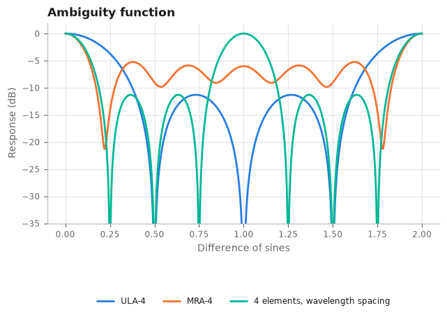
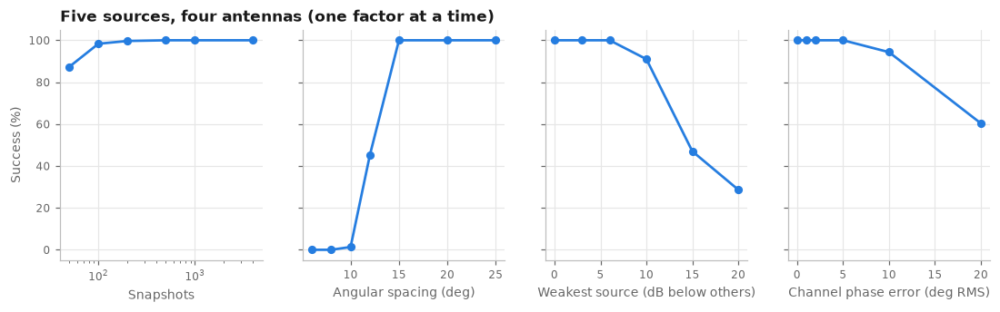
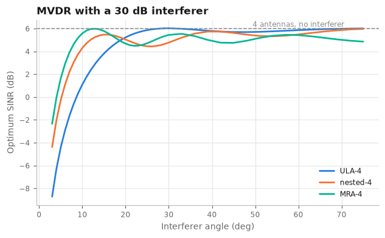

# Study 4 — Sparse antenna arrays

**Simulation only.** Hypotheses: [HYPOTHESES.md](../HYPOTHESES.md).

```bash
python -m research.sparse.run
python -m research.sparse.report
```

## Summary

1. **Four antennas can locate five sources, and one imperfection at a time rarely breaks it**: 98 % success
   with 100 snapshots, 100 % with 5° of phase error, 96 % at −10 dB.
2. **Everything at once does.** With simultaneous, realistic imperfections success is **65 %** (mild) and
   **28 %** (severe). The 50 out of 50 of the preliminary roadmap described a friendly scene.
3. What breaks it: sources closer than about one beamwidth (45 % at 12°, 1 % at 10°) and unequal powers
   (47 % when one source is 15 dB weaker).
4. Increasing SNR does not help beyond 10 dB: estimator **and** bound saturate, as expected with more
   sources than antennas. Only snapshots help.
5. As a **beamformer**, the minimum-redundancy array gains 5 dB of SINR against an interferer 5–12° from
   the target, and loses 0.6 dB elsewhere. That is its most robust advantage.
6. With two sources and imperfections its median error is half that of the uniform array, but rare large
   outliers make its RMSE worse.

## 1. Theory

Element positions $p_m$ in units of $\lambda/2$. For uncorrelated sources the covariance entries depend only on
differences: $R_{mn}=\sum_\ell P_\ell e^{-j\pi(p_m-p_n)\sin\theta_\ell}+\sigma^2\delta_{mn}$. The set of differences is the
**coarray**. If it contains all lags 0 to $M$, averaging the entries of equal difference gives the
covariance of a *virtual* uniform array of $M+1$ elements, which identifies up to $M$ sources.

| Geometry | Idea | Coarray for N = 4 |
|---|---|---|
| Uniform | all spacings equal | 0–3: at most 3 sources |
| Nested | dense part and sparse part | 0–5 |
| Minimum redundancy | each lag once | 0–6, the largest possible |

Costs. The coarray needs uncorrelated sources and enough snapshots, since virtual entries are averages of
few products. The physical beam keeps high sidelobes because few spacings fill the aperture. Any geometry
without unit spacing has true grating lobes.

**Bound.** With more sources than antennas the classical stochastic bound does not exist. The bound used
here treats angles, powers and noise as unknown with uncorrelated sources; its Fisher information stays
invertible if the coarray is rich enough. It **does not vanish when the SNR grows**: the covariance itself
must be estimated from a finite number of snapshots of random sources.

## 2. Hypotheses and verdicts

| ID | Verdict | Evidence |
|---|---|---|
| H4.1 success < 50 % at K = 100 | **refuted** | 98.3 %; 87 % even at K = 50 |
| H4.2 error saturates with SNR | supported | 0.262° at 20 dB and at 40 dB; the bound too (0.124 → 0.122°) |
| H4.3 correlation ≥ 0.5 brings success below 50 % | **refuted** | 100 % at 0.9, but with a bias: RMSE 0.13° → 1.11° |
| H4.4 5° phase error brings success below 90 % | **refuted** | 100 %; 94 % at 10°, 60 % at 20° |
| H4.5 MVDR: +3 dB near, < 1 dB lost far | supported | +4.95 dB at 5–12°, −0.61 dB beyond 15° |
| H4.6 10 dB spread brings the weakest source below 90 % | **refuted**, narrowly | 91 % (interval 87–94 %); 47 % at 15 dB |
| H4.7 combined: mild ≥ 70 %, severe < 40 % | **refuted** (mild 64.7 %), severe 27.8 % | combined table |
| H4.8 two sources: MRA has the smaller RMSE | **refuted** | 3.6° vs 1.7° (mild), 5.3° vs 4.2° (severe); its median error is smaller in both |

The author was too pessimistic about single factors (H4.1, H4.3, H4.4) and too optimistic about their
combination (H4.7): single-factor robustness does not predict combined robustness.

## 3. Experiment

Monte-Carlo, 300 trials per point (400 combined), fixed seeds. Success: every estimate within 3° of its
source. Baseline scene: sources at −50, −25, 0, 25, 50°, 10 dB each, K = 4000 unless stated, root-MUSIC on
the virtual covariance. Combined scenes are defined in HYPOTHESES.md.

Coupling model: coefficient $c/\max(1,\text{distance})$ with the propagation phase; `c` is the coupling of two
elements half a wavelength apart. It is a crude model.

## 4. Metrics

Success rate with Wilson interval, RMSE of successful trials, median and RMSE of all trials in the combined
test, output SINR for beamforming, Cramér–Rao bound.

## 5. Baselines

Uniform array with the same number of elements; uniform array with the same aperture (ULA-7); MUSIC on
the physical array.

## 6. Results

### Geometries, grating lobes, ambiguities

<!-- geometry -->

| geometry | positions (λ/2) | aperture | contiguous lags | beamwidth (deg) | sidelobe (dB) | worst response off the main lobe (dB) | at sine difference | grating lobe |
|---:|---:|---:|---:|---:|---:|---:|---:|---:|
| ULA-4 | 0 1 2 3 | 3 | 3 | 26.3 | -11.3 | -11.3 | 0.73 | no |
| nested-4 | 0 1 2 5 | 5 | 5 | 15.9 | -5.1 | -5.1 | 1.56 | no |
| MRA-4 | 0 1 4 6 | 6 | 6 | 12.2 | -5.3 | -5.3 | 0.38 | no |
| coprime-4 | 0 2 3 4 | 4 | 4 | 20.0 | -6.0 | -6.0 | 1.00 | no |
| ULA-8 | 0 1 2 3 4 5 6 7 | 7 | 7 | 12.8 | -12.8 | -12.8 | 0.36 | no |
| nested-8 | 0 1 2 3 4 9 14 19 | 19 | 19 | 4.7 | -5.4 | -5.4 | 1.88 | no |
| MRA-8 | 0 1 4 10 16 18 21 23 | 23 | 23 | 3.4 | -5.9 | -5.9 | 1.90 | no |
| ULA-7 (aperture of MRA-4) | 0 1 2 3 4 5 6 | 6 | 6 | 14.7 | -12.7 | -12.7 | 1.59 | no |
| 4 elements, wavelength spacing | 0 2 4 6 | 6 | 0 | – | 0.0 | 0.0 | 1.00 | yes |

<!-- /geometry -->



Sparse arrays with a unit spacing have **no** grating lobe, but their worst response off the main lobe is
5–6 dB below the peak instead of 11–13 dB. With wavelength spacing the second peak equals the first
(sine difference 1.00): two directions are indistinguishable whatever the SNR. With 20 snapshots at
−10 dB, conventional scanning picks a wrong lobe in 52 % of trials for MRA-4 and 47 % for ULA-4; at −5 dB
6 % and 3 %; at 0 dB none and 0.2 %.

### One factor at a time, five sources on the minimum-redundancy array

<!-- single -->

| snapshots | success | 95 % interval | weakest source found | RMSE of successes (deg) |
|---:|---:|---:|---:|---:|
| 50 | 87.3 % | 83–91 % | 93 % | 1.10 |
| 100 | 98.3 % | 96–99 % | 99 % | 0.85 |
| 200 | 99.7 % | 98–100 % | 100 % | 0.61 |
| 500 | 100.0 % | 99–100 % | 100 % | 0.39 |
| 1000 | 100.0 % | 99–100 % | 100 % | 0.26 |
| 4000 | 100.0 % | 99–100 % | 100 % | 0.14 |

| SNR (dB), K=1000 | success | 95 % interval | weakest source found | RMSE of successes (deg) | Cramér–Rao bound (deg) |
|---:|---:|---:|---:|---:|---:|
| -10 | 96.0 % | 93–98 % | 98 % | 0.93 | 0.88 |
| -5 | 100.0 % | 99–100 % | 100 % | 0.50 | 0.42 |
| 0 | 100.0 % | 99–100 % | 100 % | 0.34 | 0.24 |
| 10 | 100.0 % | 99–100 % | 100 % | 0.27 | 0.14 |
| 20 | 100.0 % | 99–100 % | 100 % | 0.26 | 0.12 |
| 40 | 100.0 % | 99–100 % | 100 % | 0.26 | 0.12 |

| spacing (deg) | success | 95 % interval | weakest source found | RMSE of successes (deg) |
|---:|---:|---:|---:|---:|
| 25 | 100.0 % | 99–100 % | 100 % | 0.14 |
| 15 | 100.0 % | 99–100 % | 100 % | 0.29 |
| 12 | 45.3 % | 40–51 % | 89 % | 1.22 |
| 10 | 1.3 % | 1–3 % | 51 % | 1.29 |
| 8 | 0.0 % | 0–1 % | 42 % | nan |

| power spread (dB), K=1000 | success | 95 % interval | weakest source found | RMSE of successes (deg) |
|---:|---:|---:|---:|---:|
| 0 | 100.0 % | 99–100 % | 100 % | 0.27 |
| 6 | 100.0 % | 99–100 % | 100 % | 0.38 |
| 10 | 91.0 % | 87–94 % | 91 % | 0.66 |
| 15 | 47.0 % | 41–53 % | 47 % | 0.69 |
| 20 | 28.7 % | 24–34 % | 29 % | 0.73 |

| correlation | success | 95 % interval | weakest source found | RMSE of successes (deg) |
|---:|---:|---:|---:|---:|
| 0.0 | 100.0 % | 99–100 % | 100 % | 0.13 |
| 0.3 | 100.0 % | 99–100 % | 100 % | 0.44 |
| 0.5 | 100.0 % | 99–100 % | 100 % | 0.66 |
| 0.9 | 100.0 % | 99–100 % | 100 % | 1.11 |

| phase error (deg RMS) | success | 95 % interval | weakest source found | RMSE of successes (deg) |
|---:|---:|---:|---:|---:|
| 0 | 100.0 % | 99–100 % | 100 % | 0.14 |
| 2 | 100.0 % | 99–100 % | 100 % | 0.28 |
| 5 | 100.0 % | 99–100 % | 100 % | 0.62 |
| 10 | 94.3 % | 91–96 % | 95 % | 1.06 |
| 20 | 60.3 % | 55–66 % | 68 % | 1.38 |

| position error (λ RMS) | success | 95 % interval | weakest source found | RMSE of successes (deg) |
|---:|---:|---:|---:|---:|
| 0 | 100.0 % | 99–100 % | 100 % | 0.13 |
| 0.01 | 100.0 % | 99–100 % | 100 % | 0.30 |
| 0.02 | 100.0 % | 99–100 % | 100 % | 0.55 |
| 0.05 | 92.3 % | 89–95 % | 94 % | 1.21 |

| coupling | success | 95 % interval | weakest source found | RMSE of successes (deg) |
|---:|---:|---:|---:|---:|
| 0 | 100.0 % | 96–100 % | 100 % | 0.14 |
| 0.1 | 100.0 % | 96–100 % | 100 % | 1.08 |
| 0.2 | 100.0 % | 96–100 % | 100 % | 1.80 |
| 0.3 | 1.0 % | 0–5 % | 33 % | 2.35 |

<!-- /single -->



The estimator stays 2.1 times above the bound at high SNR: averaging lags is simple, not efficient.

### Combined imperfections

<!-- combined -->

| sources | level | array | success | 95 % interval | median error (deg) | RMSE, all trials (deg) |
|---:|---:|---:|---:|---:|---:|---:|
| 5 | mild | MRA-4 | 64.8 % | 60–69 % | 0.68 | 3.98 |
| 5 | mild | nested-4 | 45.8 % | 41–51 % | 1.08 | 3.30 |
| 5 | severe | MRA-4 | 27.8 % | 24–32 % | 1.55 | 7.11 |
| 5 | severe | nested-4 | 8.8 % | 6–12 % | 2.80 | 6.88 |
| 2 | mild | MRA-4 | 97.5 % | 95–99 % | 0.43 | 3.56 |
| 2 | mild | ULA-4 | 86.2 % | 83–89 % | 0.88 | 1.69 |
| 2 | mild | nested-4 | 94.5 % | 92–96 % | 0.58 | 1.13 |
| 2 | severe | MRA-4 | 93.2 % | 90–95 % | 0.59 | 5.28 |
| 2 | severe | ULA-4 | 61.8 % | 57–66 % | 1.47 | 4.23 |
| 2 | severe | nested-4 | 84.2 % | 80–87 % | 0.82 | 2.73 |

<!-- /combined -->

### Two close sources (10 dB, K = 500, no imperfection)

<!-- comparison -->

| separation (deg) | array | MUSIC resolved | RMSE | coarray resolved | RMSE | Cramér–Rao bound |
|---:|---:|---:|---:|---:|---:|---:|
| 2 | ULA-4 | 0 % | nan | 17 % | 0.57 | 2.45 |
| 2 | nested-4 | 9 % | 0.53 | 22 % | 0.69 | 0.69 |
| 2 | MRA-4 | 19 % | 0.41 | 48 % | 0.70 | 0.45 |
| 2 | ULA-8 | 23 % | 0.33 | 94 % | 0.37 | 0.22 |
| 4 | ULA-4 | 23 % | 0.72 | 82 % | 0.91 | 0.80 |
| 4 | nested-4 | 97 % | 0.38 | 96 % | 0.80 | 0.27 |
| 4 | MRA-4 | 100 % | 0.27 | 100 % | 0.34 | 0.20 |
| 4 | ULA-8 | 100 % | 0.15 | 100 % | 0.14 | 0.11 |
| 6 | ULA-4 | 96 % | 0.71 | 100 % | 0.60 | 0.47 |
| 6 | nested-4 | 100 % | 0.23 | 100 % | 0.41 | 0.18 |
| 6 | MRA-4 | 100 % | 0.16 | 100 % | 0.17 | 0.14 |
| 6 | ULA-8 | 100 % | 0.08 | 100 % | 0.10 | 0.08 |
| 8 | ULA-4 | 100 % | 0.46 | 100 % | 0.39 | 0.35 |
| 8 | nested-4 | 100 % | 0.17 | 100 % | 0.25 | 0.14 |
| 8 | MRA-4 | 100 % | 0.12 | 100 % | 0.14 | 0.11 |
| 8 | ULA-8 | 100 % | 0.06 | 100 % | 0.10 | 0.06 |
| 16 | ULA-4 | 100 % | 0.21 | 100 % | 0.24 | 0.19 |
| 16 | nested-4 | 100 % | 0.07 | 100 % | 0.18 | 0.07 |
| 16 | MRA-4 | 100 % | 0.05 | 100 % | 0.14 | 0.05 |
| 16 | ULA-8 | 100 % | 0.03 | 100 % | 0.11 | 0.03 |

<!-- /comparison -->

With two sources and perfect calibration, MUSIC on the physical sparse array is *better* than the coarray
and reaches the bound: the coarray is only worth using when there are too many sources.

### Beamforming with a 30 dB interferer, target at broadside (SINR in dB, at most 6.02 for N = 4)

<!-- beam -->

| array | 5–12°: optimum | 5–12°: K=256 | > 15°: optimum | > 15°: K=256 | > 15°: worst optimum |
|---:|---:|---:|---:|---:|---:|
| MRA-4 | 4.46 | 4.34 | 5.05 | 4.95 | 4.49 |
| MRA-8 | 8.51 | 8.37 | 8.55 | 8.41 | 8.04 |
| ULA-4 | -0.49 | -0.93 | 5.66 | 5.57 | 4.18 |
| ULA-8 | 7.20 | 7.07 | 8.95 | 8.80 | 8.80 |
| nested-4 | 2.99 | 2.83 | 5.21 | 5.12 | 4.43 |

<!-- /beam -->



## 7. Limitations and conclusions

Limitations: isotropic elements, crude coupling, Gaussian sources, known number of sources (MDL on the
virtual covariance was not studied), target and sources in one plane, one success threshold.

| Decision | Reason |
|---|---|
| First physical array: keep a **uniform** 4-element array | simplest to calibrate and to compare with every algorithm of the project |
| Make the element mount re-positionable to (0, 1, 4, 6) | same hardware, tests the sparse claims for the price of a drilled plate |
| Use MRA for beamforming when a narrow beam matters and sidelobes do not | +5 dB near the target |
| Do not promise more sources than antennas on real hardware | 28–65 % with realistic errors |
| Report medians *and* tails | they disagree here |
| Next: more efficient coarray estimators (the bound is 2 × lower), order selection | gap to the bound |

## References

- P. Pal, P. P. Vaidyanathan, 2010, doi:10.1109/TSP.2010.2049264.
- † A. Moffet, "Minimum-redundancy linear arrays", *IEEE Trans. Antennas and Propagation*, 1968.
- † C.-L. Liu, P. P. Vaidyanathan, "Cramér–Rao bounds for coprime and other sparse arrays, which find more
  sources than sensors", *Digital Signal Processing*, 2017.

† cited from memory of the standard literature; verify before publication.
